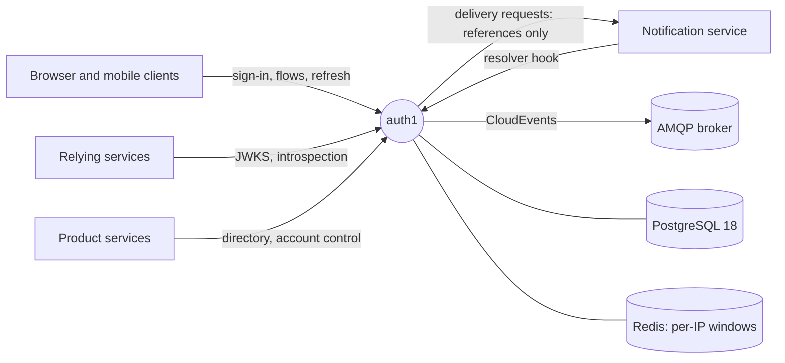

# Architecture

auth1 is being redesigned for its 1.0 release. The design is the source of truth; the code in this
repository is a pre-1.0 prototype that 1.0 replaces (no data or API compatibility is kept, since
nothing runs in production).

## Where the design lives

| Document | Read it for |
|---|---|
| [design.md](design.md) | The Software Design Description (SDD): needs, scope, architecture views, decisions D-1…D-19 with their reasons, state models, flow catalogue, invariants, threat model |
| [tdd/TDD-01](tdd/TDD-01-identity-and-data.md) | Ids (UUIDv7), identifier types and normalisation, field encryption, the schema, retention |
| [tdd/TDD-02](tdd/TDD-02-flows-and-challenges.md) | Registration, resume, sign-in, recovery, identifier changes, invitations |
| [tdd/TDD-03](tdd/TDD-03-credentials-and-mfa.md) | Argon2id, password policy, TOTP, recovery codes, enrolment, reauthentication |
| [tdd/TDD-04](tdd/TDD-04-sessions-tokens-and-keys.md) | Tokens, sessions, refresh rotation, cookies and CORS, the signing keyring, introspection |
| [tdd/TDD-05](tdd/TDD-05-service-access.md) | Workload identity, client credentials, scopes, idempotency, directory, account control |
| [tdd/TDD-06](tdd/TDD-06-events-and-delivery.md) | Outbox, relay, CloudEvents, message delivery, the resolver hook, notices |
| [tdd/TDD-07](tdd/TDD-07-abuse-protection.md) | Rate limits, client IP, device cookies, send budgets, overload |
| [tdd/TDD-08](tdd/TDD-08-operations-and-quality.md) | Binary and commands, configuration, secrets, observability, runbooks, testing, CI |
| [../api/openapi.yaml](../api/openapi.yaml) | The HTTP contract (OpenAPI 3.1) |
| [../api/asyncapi.yaml](../api/asyncapi.yaml) | The lifecycle events (AsyncAPI 3.0, CloudEvents) |

## auth1 1.0 in one page

- **Product-agnostic.** One deployment per product; every product difference is configuration.
- **Accounts and identifiers.** Several identifiers per account, each verified on its own, unique only once verified. UUIDv7 ids. Identifier values and display names encrypted per field, found by blind indexes.
- **Credentials.** Every account has a password (Argon2id with a pepper) and **mandatory TOTP**, with recovery codes. Enrolment happens at the first sign-in.
- **Flows.** Registration, resume, sign-in, recovery, identifier changes and invitations are flows with challenges, stored in PostgreSQL.
- **Sessions and tokens.** Short-lived signed access tokens (a keyring with `next`/`active`/`retired` keys, JWKS), opaque refresh tokens rotated with reuse detection. Suspended or banned accounts get restricted sessions whose tokens only auth1 accepts.
- **Services.** Authenticated by workload identity or client credentials, with scopes. No static API keys.
- **Events and messages.** A transactional outbox publishes CloudEvents ordered per account. Secrets in messages are references resolved at send time.
- **Structure.** Ports and adapters: domain and use cases know no transport, database or provider (design.md §6.3).

## The prototype in this repository

What runs today: a Chi HTTP service with email/password and OTP sign-in, optional TOTP, JWT
access and refresh tokens with Redis blacklists, an admin user API protected by a role, an
introspection endpoint protected by static API keys, and an email outbox relayed to RabbitMQ.
`CLAUDE.md` describes its layout. design.md §17 lists what 1.0 keeps from it (the Chi router, the
Redis sliding-window limiter, the outbox pattern, RS256 with a `kid`, the JWKS endpoint, the health
probes) and what it rewrites (everything else). The full gap analysis is in the history of
design.md (version 0.2, §14).
