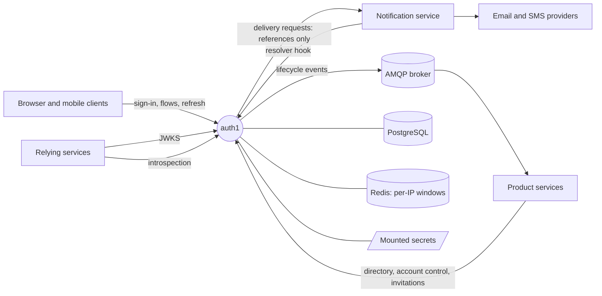
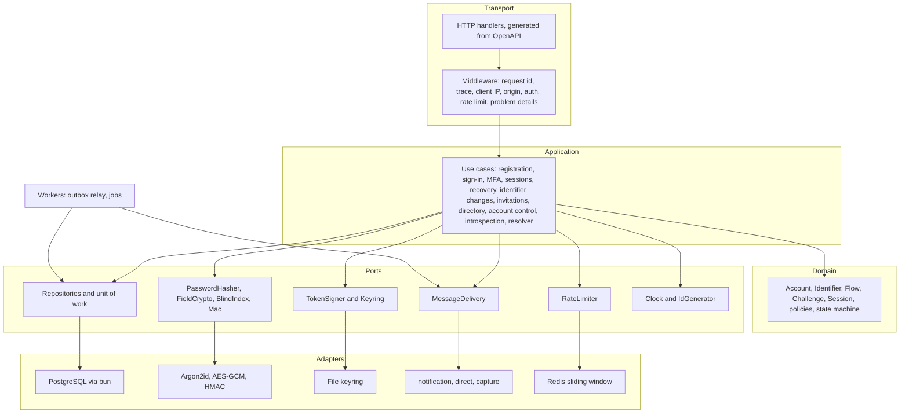
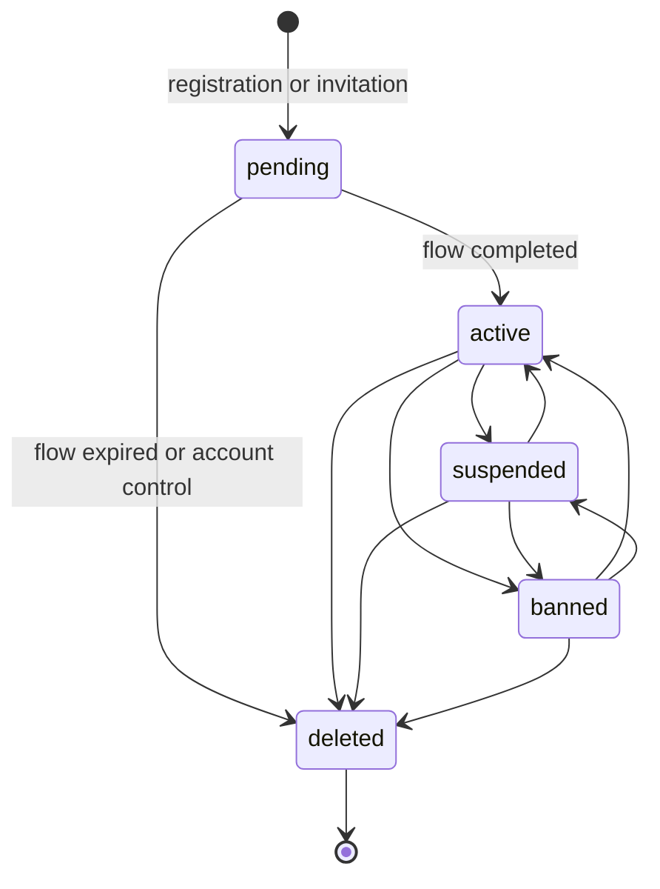
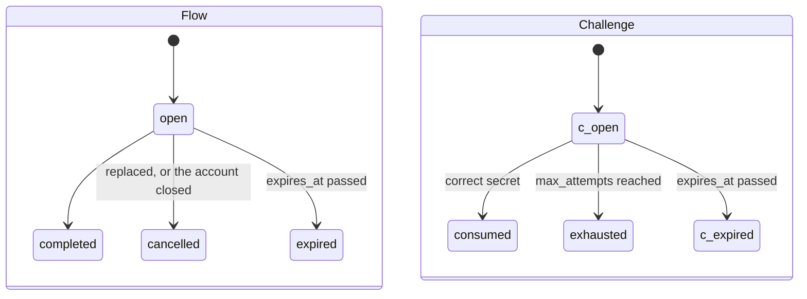
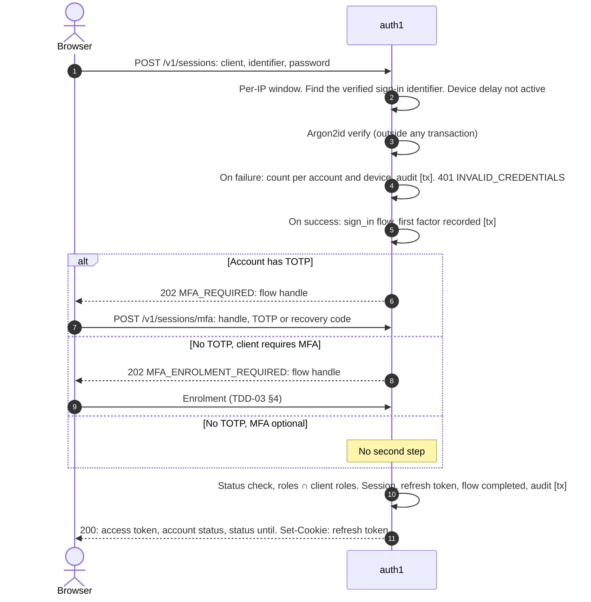
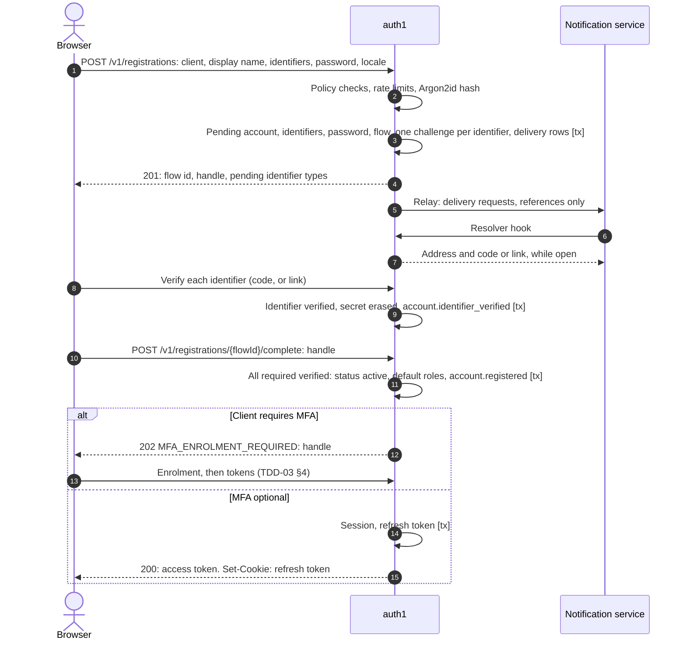
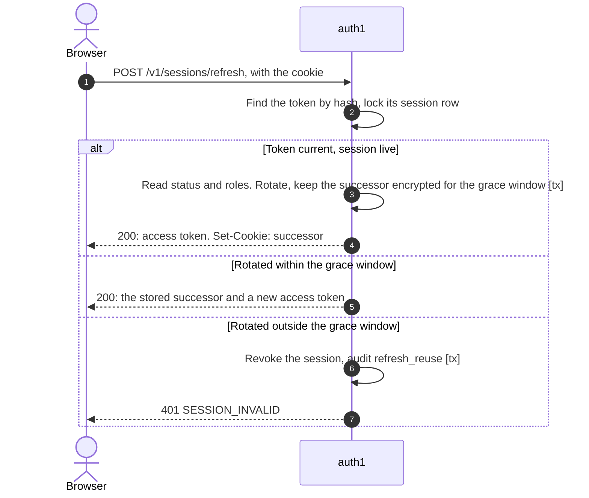
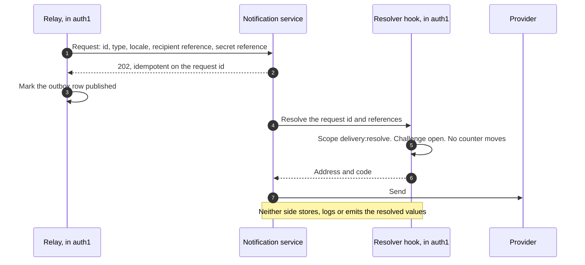

# auth1 — Software Design Description 1.0

| Field | Contents |
|---|---|
| Document | Software Design Description (SDD). High level: *what* auth1 is and *why* it is built this way |
| Status | Draft |
| Version | 0.5 (design of auth1 1.0) |
| Date | 2026-10-27 |
| Owner | Arafat Hasan |
| Detailed designs | [`docs/tdd/`](tdd/): TDD-01 … TDD-08 (§16) |
| Contracts | [`api/openapi.yaml`](../api/openapi.yaml) (OpenAPI 3.1), [`api/asyncapi.yaml`](../api/asyncapi.yaml) (AsyncAPI 3.0), aligned with 0.4 |
| Depends on | PostgreSQL 18, Redis, an AMQP 0-9-1 broker, a workload-identity source (a service mesh, or client credentials), a message-delivery service or provider |

auth1 is an identity service: accounts, credentials, second factors, identifier verification,
sessions, tokens, account state and roles. It is **product-agnostic**: its code knows no product.
Everything that differs between products is **deployment configuration**, and one deployment
serves one product, so auth1 has no tenant model.

This document is written **needs first**: §2 says what a reusable identity service must offer,
§3–§15 design auth1 from that. The TDDs (§16) hold the detail: schemas, algorithms, configuration
keys and implementation guidelines.

## Contents

1. [Introduction](#1-introduction)
2. [Needs](#2-needs)
3. [Scope and non-scope](#3-scope-and-non-scope)
4. [Assumptions and constraints](#4-assumptions-and-constraints)
5. [Quality attributes](#5-quality-attributes)
6. [Architecture](#6-architecture)
7. [Design decisions](#7-design-decisions)
8. [State models](#8-state-models)
9. [Flow catalogue](#9-flow-catalogue)
10. [Contracts and API conventions](#10-contracts-and-api-conventions)
11. [Invariants](#11-invariants)
12. [Threat model](#12-threat-model)
13. [Failure modes](#13-failure-modes)
14. [Observability](#14-observability)
15. [Verification](#15-verification)
16. [Technical design documents](#16-technical-design-documents)
17. [Implementation baseline](#17-implementation-baseline)
18. [Open items](#18-open-items)
19. [Change log](#19-change-log)

## 1. Introduction

### 1.1 Purpose and audience

This SDD is the reference for anyone who builds, reviews, operates or integrates with auth1: its
own developers, the owners of each relying product's integration, and security reviewers.

### 1.2 How the documents relate

| Document | Says | Binding on |
|---|---|---|
| This SDD | Needs, decisions and their reasons, state models, invariants, threat model | Everything below it |
| TDD-01 … TDD-08 | How each area is built: schemas, algorithms, configuration, guidelines | The implementation. Guidelines marked *(guideline)* are advice, not rules |
| `api/*.yaml` | The exact wire shapes | Clients, relying services, auth1's handlers |

When a TDD needs to change a decision, the SDD changes first. When a contract and a TDD disagree
on a wire shape, the contract wins and the TDD is corrected.

### 1.3 Glossary

| Term | Meaning |
|---|---|
| Account | A person known to auth1. Has a status, roles, identifiers, a password and, optionally, a second factor |
| Identifier | A value a person is known by (email, phone, …). Has a type, may be verified, may be current or retired |
| Blind index | An HMAC of a normalised value, used to find and de-duplicate encrypted values without decrypting them |
| Client | A first-party application that people sign in to (a web app, a console, a mobile app) |
| Relying service | A backend service that accepts auth1's access tokens |
| Service caller | A backend service that calls auth1's service APIs (introspection, directory, account control) |
| Flow | A multi-step interaction (registration, sign-in, recovery, …), held in PostgreSQL |
| Handle | An opaque 256-bit value the browser holds to continue a flow |
| Challenge | One secret auth1 sends (an OTP or a link) inside a flow |
| Session | The result of a complete sign-in, per client. Holds a chain of refresh tokens |
| Restricted session | A session of a suspended or banned account. Its tokens are for auth1 only |
| Second factor | TOTP, or one of the account's recovery codes |
| Enrolment | Registering a TOTP factor: by the person at any time, or during sign-in on a client that requires MFA |
| Outbox | A table written in the same transaction as a change, relayed afterwards to the broker or the notification service |
| Resolver hook | The endpoint a notification service calls at send time to turn auth1's references into an address and a secret |
| Keyring | The set of signing keys, each `next`, `active` or `retired` |
| *(cfg)* | A deployment setting. Its key and default are in TDD-08 |
| `[tx]` | One PostgreSQL transaction, including its outbox rows |

## 2. Needs

What any product needs from an identity service it runs as its own. They were first derived from
the first relying product's change requests (CR-AUTH-01…12) and its identity design; they are
stated here so that this document stands on its own.

| # | Need |
|---|---|
| N-1 | An account with **several identifiers** (email, phone, …), each verified on its own. Which are required, how each is verified and which can sign in are set by the deployment |
| N-2 | An identifier is **unique only once verified**. A configurable policy for formats and allowed country calling codes |
| N-3 | **Every account has a password**, stored as an adaptive hash, with a policy that includes "must not contain an identifier" |
| N-4 | First-factor sign-in methods chosen per client: password, or an OTP to a sign-in identifier. Verifying an identifier by OTP is separate from signing in by OTP |
| N-5 | Recovery of a forgotten password by a link to a verified identifier, **with the second factor when the account has one**, and a configurable SMS step-up otherwise |
| N-6 | Changing an identifier safely: an email change confirmed by both addresses (or, by policy, notified to the old one); a phone change verified on the new number; uniqueness checked |
| N-7 | **Account states** (pending, active, suspended until a date, banned, deleted) with reason codes, honoured by every flow, visible in tokens and introspection, with a **restricted session** so a client can explain the state |
| N-8 | **Lifecycle events**, at least once, ordered per account, with stable ids, through an outbox to the service's own exchange, with no secrets or identifier values |
| N-9 | **Service callers authorised by workload identity** and scopes, with client credentials for products without a mesh. No static keys |
| N-10 | A **directory** for services: batch lookup, exact search by email and phone, listing by status and role |
| N-11 | A **locale** per account, and **pluggable message delivery**: through a notification service, or a provider directly |
| N-12 | An **audience per client**, and **several roles** per account from a configured catalog |
| N-13 | Short-lived signed access tokens, rotated refresh tokens, a JWKS, key rotation by `kid` |
| N-14 | Introspection with revocation state |
| N-15 | Rate limits and abuse controls on sign-in, OTP, recovery and registration, per account, per target and per IP |
| N-16 | Staff administration through the product's services: inviting accounts, granting and revoking roles, changing state, closing accounts, resetting a lost second factor |
| N-17 | Runs as part of the product's system: its database, broker, mesh and observability; HA; 99.9% for sign-in, refresh and JWKS |
| N-18 | Nothing product-specific in code |
| N-19 | **Optional multi-factor authentication.** Any account may enrol TOTP, with recovery codes for a lost device; a client may require it; a service-driven reset covers losing both |
| N-20 | **Security notifications** to the account's own addresses when its password, identifiers, second factor or sessions change |

### 2.1 Traceability

| Need | Decisions | TDD |
|---|---|---|
| N-1, N-2 | D-2, D-3 | TDD-01, TDD-02 |
| N-3 | D-7 | TDD-03 |
| N-4 | D-6 | TDD-02 |
| N-5 | D-10 | TDD-02, TDD-03 |
| N-6 | D-11 | TDD-02 |
| N-7 | D-5 | TDD-02, TDD-04 |
| N-8 | D-15 | TDD-06 |
| N-9 | D-13 | TDD-05 |
| N-10, N-16 | D-14, D-11 | TDD-05 |
| N-11, N-20 | D-16 | TDD-06 |
| N-12 | D-6 | TDD-04 |
| N-13, N-14 | D-12 | TDD-04 |
| N-15 | D-17 | TDD-07 |
| N-17 | D-19, §13, §14 | TDD-08 |
| N-18 | D-1 | TDD-08 |
| N-19 | D-8, D-9 | TDD-03 |

## 3. Scope and non-scope

**In scope:** everything in §2.

**Not in scope.**

| Topic | Why |
|---|---|
| Anything about the product's domain: profiles, consent, payments, sanctions as decisions | The product decides; auth1 enforces the resulting account state |
| Deciding when an account is suspended or reinstated | The product orchestrates it. auth1 records `until` for display only (D-5) |
| Identity proofing before a second-factor reset or a support-driven identifier change | The product's support process. auth1 offers the operation (D-8, D-11) |
| Templates and wording of messages | The notification service's catalog, or mounted templates for the direct adapter |
| Passwordless accounts | Every account has a password (N-3) |
| Multi-tenancy | One deployment per product |
| OpenID Connect, third-party clients, social sign-in | Not needed yet (O-4). The session and token design leaves room for them |
| Passkeys / WebAuthn | Planned as a second factor after 1.0 (O-5) |
| Browser clients on a different site from auth1 | Needs a redirect-based protocol (O-4). 1.0 assumes A-2 |
| A human administration UI | The product builds it on the service APIs (D-14) |

## 4. Assumptions and constraints

| # | Assumption |
|---|---|
| A-1 | One deployment per product, with its own database, broker exchange, keys and configuration |
| A-2 | Browser clients are served from the **same site** (registrable domain) as auth1, for example `id.example.com` and `www.example.com`. The refresh cookie depends on it (D-12) |
| A-3 | Relying services validate access tokens locally and refresh the JWKS at least every `keys.min_publish_before_use` |
| A-4 | Node clocks are synchronised (NTP); skew stays under 30 s |
| A-5 | Service callers reach auth1 through the product's mesh, or use client credentials |
| A-6 | A notification service (or an SMTP server and an SMS provider) is available |
| A-7 | The platform runs PostgreSQL highly available with point-in-time recovery, and encrypts volumes and backups |

| # | Constraint |
|---|---|
| C-1 | Go (current stable release), Chi v5, `uptrace/bun` on PostgreSQL 18, `go-redis` v9, `amqp091-go`, OpenTelemetry |
| C-2 | No product word in code, default configuration or migrations (D-1) |
| C-3 | Security floors (TDD-08 §3) cannot be configured below their minimum outside `development` |
| C-4 | Contract first: handlers are generated from `api/openapi.yaml`; a breaking change fails CI |

## 5. Quality attributes

| Attribute | Target |
|---|---|
| Security | OWASP ASVS 5.0 Level 2 as the verification baseline. NIST SP 800-63B-4 for passwords and authenticators. OAuth 2.0 Security BCP (RFC 9700) for tokens |
| Availability | 99.9% a month for sign-in, refresh and the JWKS |
| Latency (p95) | Sign-in first factor < 500 ms (Argon2id dominates); second factor < 200 ms; refresh < 300 ms; JWKS < 200 ms; introspection < 100 ms |
| Throughput | Scales horizontally; sign-in is bounded by Argon2id CPU and memory per replica (D-7) |
| Privacy | No personal data in tokens, events or logs. Identifier values and display names encrypted per field. Audit IPs cleared after 90 days *(cfg)* |
| Recoverability | RPO ≤ 5 min and RTO ≤ 1 h, from the platform's PostgreSQL recovery (D-19) |
| Operability | Stateless replicas; every job leader-elected; every alert actionable (§14) |
| Portability | Any product, by configuration only (D-1) |
| Maintainability | Contract-first API; hexagonal structure (§6.3); every invariant has a test (§15) |

## 6. Architecture

### 6.1 System context

Every call between services goes over the product's mesh (mTLS), or uses client credentials (D-13).

### 6.2 Runtime and deployment

- **One binary, `auth1`**, with subcommands: `serve` (HTTP API, outbox relay, jobs), `migrate` (schema, run as a pre-deploy job), and operator commands (`keys`, `sessions`, `outbox`, `crypto`, `accounts erase`). Every operator command is audited.
- **Replicas.** At least two, across nodes, behind the product's edge. No local state: a replica can be killed at any time.
- **Relay.** Runs on every replica; rows are claimed with `FOR UPDATE SKIP LOCKED` (D-15).
- **Jobs.** Expiry, purges, erasures, partition creation. Each elects one leader with a PostgreSQL advisory lock.
- **Secrets** are files mounted into the pod and re-read on change (D-18).

### 6.3 Components

auth1 is built **ports and adapters**: the domain and use cases know no transport, database or
provider.

Rules for every use case:

- **One transaction per use case.** A state change and its outbox rows commit together, or not at all.
- **No network call and no password hashing inside a transaction.** Hash first, then open the transaction.
- **Domain code is pure:** no I/O, the clock and ids injected. It holds the state machines and policies, and is unit-tested exhaustively.

The package layout is a guideline in TDD-08.

### 6.4 Data ownership

| Store | Holds | If lost |
|---|---|---|
| PostgreSQL | Everything that matters: accounts, identifiers, credentials, factors, flows, challenges, sessions, refresh tokens, idempotency keys, key publication times, audit, outbox | auth1 is down (§13) |
| Redis | Per-IP sliding windows only | Per-IP limits fail open; nothing else changes |
| Broker | Nothing auth1 reads | Events wait in the outbox |
| Mounted secrets | Signing keys, field-encryption keys, MAC keys, the pepper, provider credentials | auth1 refuses to start |

## 7. Design decisions

Each decision gives what is decided, why, and what was rejected. Detail is in the TDD named at the end.

### D-1. Mechanisms in code, policy in configuration

| Configuration (per deployment) | Code |
|---|---|
| Issuer, base path, trusted proxies; the clients (audience, roles, first factors, registration, origins, link URLs) | Token, session and key machinery |
| The identifier policy: types, required, verification method, sign-in, formats, calling codes | Normalisation, uniqueness, verification |
| The password policy and deny-list; Argon2id parameters above the floor | Hashing, checks |
| The role catalog; bootstrap admins | Roles and the client intersection |
| The status reason codes | The state machine |
| Lifetimes, OTP length and attempts, rate limits | Their enforcement |
| The delivery adapter, message types, locales, which notices are sent | Challenges, the resolver hook, adapters |
| The service callers and their scopes; client-credentials clients | Scope enforcement |
| The event exchange and `source` | Outbox and relay |

**Not configurable:** that every account has a password, that an account with TOTP is always asked
for it, and the security floors (C-3).

**A design rule, not a check.** No product name appears in the code, the default configuration or
the migrations. Any product deploys auth1 in its own cluster and keeps its configuration in its own
repository. Reviews keep the rule; nothing in CI scans for product words.

### D-2. Identifiers of records: UUIDv7

**Decision.** Every primary key that is an id is a **UUIDv7** (RFC 9562), generated in the
application and stored as `uuid`. This includes account ids (`sub`), sessions, flows, challenges
and outbox rows. The audit log uses a `bigint` identity.

**Why.**
- Time-ordered keys insert at the right edge of the B-tree: fewer page splits, less WAL, better cache locality than random v4 keys.
- Ids sort by creation, so cursor pagination and "newest first" need no extra index.
- Generating ids in the application lets a use case know an id before it writes, which simplifies outbox rows and tests (with an injected generator).

**Cost, accepted.** A v7 id reveals its creation time to the millisecond. As `sub` it tells a
relying service when the account was created, which is not sensitive for any known product.

**Rule (I-20): no id is a capability.** A v7 id has only 74 random bits and is visible to many
parties. Possession of an id never authorises anything. Every operation on a flow also needs the
flow's handle or link token, which are separate 256-bit random values.

| Option | Verdict |
|---|---|
| UUIDv4 (the 0.2 design) | Rejected. Random inserts fragment indexes; no natural order |
| `bigint` sequences | Rejected. Enumerable, and they leak volumes across the API |
| **UUIDv7, generated in the application** | **Chosen** |

*Detail: TDD-01 §1.*

### D-3. Accounts and identifiers

- An **account** has an id, a status, a display name, a locale, a version and timestamps.
- An **identifier** is a row: type (from the policy), the normalised value, a verification time, and whether it is still current. An account has at most one current identifier per type.
- **Uniqueness applies to verified, current identifiers only**: a partial unique index on `(type, blind index)`. An unverified value never blocks another account. When two accounts race to verify the same value, the index settles it and the loser gets `IDENTIFIER_TAKEN`.
- **Identifier types** are a small registry in code: each type provides normalisation, validation, its verification methods and whether it can sign in. 1.0 ships `email` and `phone`; others (for example `username`) are added as types, without schema changes.
- **Normalisation.** Email: trimmed, Unicode NFC, domain converted to its IDNA ASCII form, lower-cased; no provider-specific folding. Phone: parsed to E.164; refused unless its calling code is in the policy's list and the number fits the policy.
- **Storage.** The value is encrypted per field, and found by a blind index (D-18).
- **Expiry releases.** When a `pending` account's registration or invitation expires, its identifiers are retired at once, so an abandoned registration stops holding a value it verified. The row itself is purged later (D-19).

| Option | Verdict |
|---|---|
| A column per identifier type on the account, unique when stored (today's code) | Rejected. An unverified registration squats on a value; one column cannot hold a pending change |
| **Identifier rows, unique once verified and current** | **Chosen.** Each identifier is verified on its own, and a change is a new row |
| Uniqueness checked in code, without an index | Rejected. Two concurrent verifications would both pass |

*Detail: TDD-01 §2–§4.*

### D-4. Flows and challenges

Every multi-step interaction is a **flow**, stored in PostgreSQL. Kinds: `registration`,
`invitation`, `sign_in`, `password_reset`, `email_change`, `phone_change`. A flow has a kind, an
account, a client, a handle, non-secret state (for example the first factor already passed) and an
expiry.

A flow owns **challenges**, one for each secret auth1 sends. A challenge has a purpose, a method
(`sms_otp`, `email_link`, `email_code`), the **blind index of the address it is sent to**, the
secret's MAC, attempt and send counters, and an expiry. While it is open it also holds the secret
encrypted, so that it can be resolved at delivery time (D-16). When it closes, the secret is erased.

- **OTP:** 6 digits *(cfg, at least 6)* from a CSPRNG, verified by HMAC-SHA256 under a server key, in constant time. **Link token:** 256 bits, stored as SHA-256.
- **Resending** reuses the open challenge and its secret. A new secret is drawn only when a new challenge opens. Sends are counted when the delivery is requested, never when it is resolved.
- **Send limits are per target value** (the blind index), not per row: ten pending accounts with the same address share one budget (D-17).
- **Resuming a flow by possession.** A browser that loses its handle calls `POST /v1/registrations/resume` with an identifier. The answer is always 202. For each open registration or invitation that holds that value, auth1 sends a resume message to that address, by the identifier type's verification method. Following it proves possession, so it also verifies the identifier, and it gives a new handle in place of the old one. Sign-in never resumes a flow. A pending account whose sign-in identifier is verified, with the correct password, gets `403 REGISTRATION_INCOMPLETE` and the client offers resume.

| Option | Verdict |
|---|---|
| Pending registrations in Redis (today's code) | Rejected. Lost on a Redis failure, not transactional with the outbox, not auditable |
| **Flows and challenges in PostgreSQL** | **Chosen.** One transaction writes the challenge and its delivery row; attempts and sends survive restarts |
| Resume on sign-in with the correct password (0.2) | Rejected. Sign-in finds only verified identifiers, and several pending accounts may hold the same unverified value |

*Detail: TDD-02.*

### D-5. Account states

States: `pending`, `active`, `suspended`, `banned`, `deleted`. `suspended` and `banned` carry a
`reason_code` from the configured list; `suspended` may carry `until`. The state machine and the
behaviour of every flow in every state are in §8.1.

- **Restricted session.** A suspended or banned account that signs in, with every factor its sign-in requires, gets a restricted session. Its access tokens have **auth1's own audience** (`tokens.self_audience`), never a client's, so every relying service refuses them through its normal audience check: a forgotten status check fails closed. auth1 accepts them only on `GET /v1/me`, the session list and sign-out. The token response carries `account_status` and `status_until`, so the client can explain the state. Whether a sanctioned account may sign in at all is configuration (`statuses.restricted_sign_in`); if not, it gets `ACCOUNT_RESTRICTED`.
- **A status change leaves sessions alone by default.** Every refresh reads the account's current status and roles (one primary-key read), so the first refresh after a change carries it. The caller may ask for `revoke_sessions: true`, for example on a ban for account takeover.
- **`until` is information only.** auth1 never changes a status on a timer. A product that wants automatic reinstatement runs it where it decides sanctions.
- **Deletion** revokes every session, erases the password hash, the TOTP factor and the recovery codes, and releases the identifiers. The account row and identifiers remain, encrypted, for audit (D-19).
- **Version.** Every change to an account's status, roles, identifiers, credentials, factors or profile increments `accounts.version`, under the account row's lock. Events carry it and are ordered by it (D-15).

| Option | Verdict |
|---|---|
| `is_active` and a soft delete (today's code) | Rejected. No suspension or ban, no reason, nothing for a client to explain |
| auth1 lifts a suspension when `until` passes | Rejected. The product usually has other steps to undo |
| Revoke every session on every sanction | Rejected as the default. The client could not tell the person why. Available per request |
| Restricted tokens with a client's audience and a `status` claim (0.2) | Rejected. Safe only if every relying service checks `status`. One forgotten check fails open |

### D-6. Clients, the first-party API, sign-in and roles

**auth1 offers a first-party API, not an OAuth authorization server for user sign-in.** Clients
post credentials to auth1's JSON endpoints directly; there is no redirect, authorization code or
consent screen. This fits 1.0: every client belongs to the product, is served from the same site
(A-2), and owns its sign-in screens. It cannot serve third-party clients or clients on another
site; that is OpenID Connect with authorization code and PKCE, which can later reuse the same
sessions, tokens and keys (O-4).

A **client** is configured per deployment:

| Setting | Meaning |
|---|---|
| `id` | Sent by the client on sign-in and registration |
| `audience` | The `aud` of full tokens issued to it |
| `allowed_roles` | Token roles = account roles ∩ allowed roles. An empty intersection refuses sign-in with `ROLE_NOT_PERMITTED` |
| `default_roles` | Given to accounts that register through it |
| `first_factors` | `[password]` or `[password, otp]`. The second factor, when used, is TOTP (D-8) |
| `mfa` | `optional` (default) or `required`. On a `required` client, an account without TOTP must enrol before it gets a session (D-8) |
| `self_registration` | Whether it may start registrations. Otherwise accounts arrive by invitation |
| `refresh_transport` | `cookie` (browser) or `body` (native app) |
| `origins`, `link_base_url` | Allowed origins (also the CORS allow-list); the base URL of emailed links |

**The client id is not a secret.** Browser and native clients are public clients: anyone can send
any `client_id`. The controls are the origin check, the role intersection and the per-client
audience: a caller claiming a client gets only what that client's policy allows for that account.

**The audience is the client.** A relying service accepts the audiences of the clients whose users
it serves. Resource-scoped audiences (RFC 8707) are better for third-party clients, and are
revisited with OpenID Connect (O-4).

**Roles** come from a configured catalog. An account holds a set. auth1 knows no hierarchy. When a
role is removed, the account's sessions are revoked *(cfg: `roles.revoke_sessions_on_removal`)*.

| Option | Verdict |
|---|---|
| OAuth 2.1 authorization code + PKCE for first-party clients in 1.0 | Deferred. Redirects buy nothing for same-site first-party clients, and they add a consent and browser-redirect surface |
| One role per account (today's code) | Rejected. Cannot express an account with two duties |
| **A role set per account, intersected with the client's allowed roles** | **Chosen** |

*Detail: TDD-02 (sign-in), TDD-04 (claims, transport).*

### D-7. Passwords

- **Every account that is not `pending` or `deleted` has a password** (I-17). There is no passwordless account.
- **Policy.** Length 12 to 128 characters by default *(cfg; floor 8, maximum at least 64)*. No composition rules. Refused if it equals or contains, case-insensitively, any identifier of the account (an email, its local part, a phone in E.164 or national form), or appears in the deny-list.
- **Length and NIST.** NIST SP 800-63B-4 asks for 15 characters when a password is the only factor, and allows 8 alongside a second factor. Since MFA is optional (D-8), many accounts sign in with a password alone. The default of 12 is a **conscious deviation** for usability, offset by the deny-list, the identifier check, throttling (D-17) and breached-password screening at the deny-list's size. A deployment that wants strict conformance sets `min_length: 15`.
- **Hash: Argon2id** (RFC 9106), stored as a PHC string with its parameters. Defaults: 64 MiB memory, 2 iterations, parallelism 1 *(cfg)*. Floors: 19 MiB, 2 iterations (the OWASP minimum profile). The parameters are tuned so one hash takes about 100–250 ms on the target CPU (O-3).
- **Pepper.** The password is HMAC-SHA256'd under a secret pepper key before hashing. A database dump alone cannot be attacked offline. The pepper's key id is stored beside the hash, so the pepper can be rotated by rehashing at sign-in.
- **Bounded memory.** A semaphore per replica bounds concurrent hashes (`max_concurrent` × memory is the peak). A request that cannot get a slot within a short wait gets `503 UNAVAILABLE` with `Retry-After`. Hashing never runs inside a database transaction.
- **Rehash on sign-in** when the stored parameters or pepper key are older than the configured ones.
- **Unknown identifiers** still run one hash against a fixed dummy, so timing does not reveal whether an account exists.
- A **password change** needs reauthentication (D-9), revokes every other session, sends a notice and emits `account.password_changed`.

| Option | Verdict |
|---|---|
| bcrypt, cost 12, with a SHA-256 pre-hash (0.2) | Rejected. Weaker against GPU and ASIC attacks; the pre-hash works around a 72-byte limit Argon2id does not have. The 0.2 objection to Argon2id, memory per pod, is met by the semaphore |
| scrypt | Rejected. Argon2id is the current recommendation, with a mature Go implementation (`golang.org/x/crypto/argon2`) |
| **Argon2id with a pepper and bounded concurrency** | **Chosen** |

*Detail: TDD-03 §1–§2.*

### D-8. Multi-factor authentication

MFA is **optional for each account**, and **a client may require it**. An account that has a second
factor is always asked for it (I-16).

- **Factors.** TOTP (RFC 6238: 6 digits, 30-second step, ±1 step of drift *(cfg)*, HMAC-SHA1 for authenticator-app compatibility), and **recovery codes**: 10 single-use codes of about 50 bits each, shown once, stored as MACs.
- **One TOTP factor per account** in 1.0. Its secret is encrypted per field. The last accepted step is recorded, so a code is never accepted twice (I-19).
- **Client policy.** Each client has `mfa: optional` (default) or `required` (D-6). A product requires MFA where it matters, for example on a staff console, and leaves it optional elsewhere.
- **Sign-in.** After the first factor:
  - an account with a confirmed TOTP gets `202 MFA_REQUIRED` and a flow handle, on **every** client, then gives a TOTP code or a recovery code;
  - an account without one, on a `required` client, gets `202 MFA_ENROLMENT_REQUIRED` and must enrol before any session is issued;
  - otherwise it gets its tokens at once (`200`).

  The sign-in flow allows 5 second-factor attempts *(cfg)* and lives 10 minutes *(cfg)*.
- **Enrolment** has two entry points:
  - **Self-service:** a signed-in person enables TOTP from `/v1/me/totp` with reauthentication (D-9).
  - **Forced:** inside sign-in on a `required` client.

  Either way the person confirms a first code, the recovery codes are returned once, and `account.mfa_enrolled` is emitted. Registration and invitation completion lead to forced enrolment only on a `required` client; otherwise they sign in at once.
- **Removing MFA.** A person may turn TOTP off with reauthentication (D-9). That erases the factor and the recovery codes, sends a notice, and emits `account.mfa_removed`. The account's next sign-in on a `required` client enrols again.
- **Replacing the factor** (a new phone) needs reauthentication, then a new secret confirmed by a code. The old factor stays in use until the new one is confirmed.
- **Recovery codes** can be regenerated with reauthentication; that replaces all of them. `GET /v1/me` shows how many remain. Using one sends a notice.
- **Losing both the device and the recovery codes.** A product service with `accounts:mfa:reset`, after its own identity proofing, calls `POST /v1/accounts/{id}/mfa/reset`. This erases the factor and the codes, revokes every session, sends a notice, and emits `account.mfa_reset`.
- **`amr`.** The first factor (`pwd`, `sms` for an SMS code, `email` for an email code), plus, when a second factor was given, `otp` for TOTP or `rcode` for a recovery code, and `mfa`. `email` and `rcode` are auth1 values outside the RFC 8176 registry. A relying service that wants MFA for an operation checks that `amr` contains `mfa`.
- **Restricted sessions** follow the same rules. The status is applied after the factors.

| Option | Verdict |
|---|---|
| MFA mandatory for every account (0.3) | Rejected. A product decision: MFA stays optional, and a client can require it where it matters |
| MFA purely an account choice, with no client policy | Rejected. There would be no way to require MFA for staff or administrative access |
| Client policy only, with no self-service enrolment (0.2) | Rejected. People could not protect their own accounts on optional clients |
| SMS or email code as the second factor | Rejected. SMS is open to SIM swap and costs money per attempt (NIST calls it "restricted"). Email is also the recovery channel, so an email factor plus an email reset would be one factor |
| **Optional TOTP + recovery codes per account; `mfa: required` per client; self-service enrolment and removal; a service-driven reset** | **Chosen** |
| WebAuthn / passkeys | Planned after 1.0 as a second TOTP-equivalent factor, and the phishing-resistant one (O-5) |

*Detail: TDD-03 §3–§7.*

### D-9. Reauthentication for sensitive operations

A **sensitive operation** needs, in the same request, the current password **and**, when the account
has TOTP, a second-factor code (TOTP or recovery code). The sensitive operations are:
- changing the password;
- changing an email or phone;
- enabling, replacing or removing the TOTP factor;
- regenerating recovery codes.

- A wrong or missing value answers `403 REAUTHENTICATION_REQUIRED`, and counts as a failed sign-in and a failed factor verification for the account (D-17).
- Restricted sessions cannot perform sensitive operations (`ACCOUNT_RESTRICTED`).
- Access tokens carry `auth_time` for relying services that want their own freshness rule, but auth1 does not use it.

| Option | Verdict |
|---|---|
| A freshness window on `auth_time` (sudo mode) | Rejected for 1.0. It needs state and a re-sign-in path, and a stolen access token would carry the freshness with it |
| Password only, even for accounts with TOTP (0.2) | Rejected. A stolen password alone would be enough to take over the account's email |
| **Password, plus the second factor when the account has one, in the request** | **Chosen.** Stateless, and the same proof as a sign-in |

### D-10. Recovery

1. `POST /v1/password-resets` with an identifier of type `recovery.via` *(cfg, default `email`)*. Always 202. If a current, verified identifier matches an account that is not `deleted` or `pending`, auth1 opens a reset flow and sends `password_reset_link`.
2. The link opens the client's page, which calls `POST /v1/password-resets/start` with the token. auth1 answers which proof completing the reset needs:
   - `totp` (a TOTP code or a recovery code) when the account has TOTP;
   - otherwise `sms` when `recovery.sms_step_up` *(cfg, default off)* is on and the account has a verified phone, in which case auth1 sends a code (`password_reset_code`) and returns the masked phone;
   - otherwise `none`.
3. `POST /v1/password-resets/{flowId}/complete` with the token, the proof `start` asked for, and the new password. auth1 checks the policy, stores the new hash, revokes every session, leaves the status and the TOTP factor unchanged, sends a notice and emits `account.password_reset`.

- **Possession of the mailbox alone never resets an account with TOTP.** That would let whoever holds the email bypass MFA.
- **An account without TOTP** resets with the link alone, unless the SMS step-up applies. For such an account the mailbox is the recovery factor: the residual risk is in §12, and a person who wants more protection enables TOTP.
- A person who lost **both the password and the second factor** goes through the product's support and `POST /v1/accounts/{id}/mfa/reset` (D-8), then resets.

| Option | Verdict |
|---|---|
| Reset by link alone for every account | Rejected. For an account with TOTP, the email owner would bypass the second factor |
| SMS step-up always required when a phone exists | Rejected as the default. SIM swap and cost make it a weak, expensive factor; it is available by configuration |
| **The account's TOTP when it has one; otherwise the link, plus SMS when configured** | **Chosen** |

*Detail: TDD-02 §6.*

### D-11. Identifier changes and invitations

- **Email change.** Reauthentication (D-9). auth1 refuses a value that is another account's verified email, then sends `email_change_confirm_new` to the new address. The old address, by `identifier_changes.confirm_old_email` *(cfg)*:
  - `required` (default): it receives `email_change_confirm_old` and must confirm too. The change applies when both are confirmed.
  - `notify`: it receives a notice, and the change applies on the new address's confirmation.
- **When the old mailbox is lost** and the policy is `required`, the product's support, after its own identity proofing, starts the change through account control (`POST /v1/accounts/{id}/identifier-changes`, `accounts:identifiers:write`). Only the new address confirms; the account's other addresses get a notice.
- **Phone change.** Reauthentication. An OTP goes to the new number; on success the unique index settles uniqueness and the swap applies. The account's email receives a notice.
- **Invitation.** A service with `accounts:invite` invites an email with a display name, a client and roles. An email that is another account's verified email gets `409 IDENTIFIER_TAKEN`. Otherwise auth1 creates a `pending` account, opens an `invitation` flow and sends `invitation_link`.
- **Accepting an invitation** takes the link token (which verifies the email), a password, and a value for every other identifier the policy requires. The flow then continues exactly like a registration: one challenge per remaining identifier, then `complete`, then, on a client that requires MFA, enrolment (D-8). An invited account is held to the same identifier policy as a registered one.
- Invitations expire after 72 h *(cfg)*; an expired invitation retires its identifiers (D-3).
- **Bootstrap.** If no account holds a role in `bootstrap.roles`, auth1 invites each email in `bootstrap.emails_file` with that role at start-up. It does nothing once one exists.

*Detail: TDD-02 §7–§9.*

### D-12. Tokens, sessions and keys

**Access token.** A JWT, `typ: at+jwt` (RFC 9068), 15 minutes *(cfg; at most 15)*. Claims: `iss`,
`sub`, `aud`, `exp`, `iat`, `nbf`, `jti`, `sid`, `client_id`, `roles`, `status`, `amr`,
`auth_time`. **No email, phone or name**: tokens are cached by browsers and logged by proxies. A
restricted session's tokens have `aud` = `tokens.self_audience` (D-5).

**Sessions.** Created when a sign-in completes, per client. A session has an idle expiry (7 days
*(cfg)*), an absolute expiry (30 days *(cfg)*), the `amr` and `auth_time` of its sign-in, and a
revocation time. It holds no copy of the account's status or roles; a refresh reads them from the
account.

**Refresh tokens** are opaque 256-bit values, stored as SHA-256, chained per session. Each use
rotates the token.
- **Reuse detection.** A rotated token presented again after the grace window (10 s *(cfg)*) revokes the session and is audited.
- **Inside the window**, auth1 returns the successor already issued, with a new access token, so two tabs refreshing at once do not sign the person out. It keeps the successor's raw value encrypted for the window only; a job erases it.

**Transport.**
- **Browser clients:** the refresh token travels in a cookie, `HttpOnly`, `Secure`, `SameSite=Strict`, path-scoped to the session endpoints. This relies on A-2.
- **CORS** allows exactly the configured origins, with credentials; never a wildcard.
- **State-changing endpoints** accept only `application/json` and check `Origin`.
- **Clients keep the access token in memory** *(guideline)*.
- **Native clients** receive the refresh token in the body.

**Revocation.**
- Sign-out revokes the session.
- A password change (all but the current one), password reset, MFA reset or deletion revokes all of them.
- A status or role change takes effect at the next refresh, or at once with `revoke_sessions` (D-5).
- **Accepted residual risk:** an access token stays valid at relying services for up to 15 minutes after its session is revoked. A relying service that needs immediacy introspects.

**Signing keys.** A keyring loaded from a mounted secret. Each key has a `kid` (its RFC 7638
thumbprint), an algorithm (`RS256` by default, 2048 or 3072 bits; `ES256` allowed), and a state:

| State | In the JWKS | Signs |
|---|---|---|
| `next` | Yes | No |
| `active` | Yes | Yes. Exactly one |
| `retired` | Until `retired_at` + the access-token lifetime + 5 min | No |

A rotation is a configuration change: add a `next` key; after `keys.min_publish_before_use`
(default 15 min), mark it `active`, which retires the previous one. auth1 refuses to sign with a key
that has not been published that long (I-14). The publication times live in PostgreSQL, so the
rule holds across restarts and replicas.

**Introspection** (RFC 7662, `tokens:introspect`). `active` is false if the signature, expiry or
issuer fails, the audience is neither one of the deployment's clients nor the self audience, the
session is revoked or expired, or the account is deleted. Otherwise it returns `sub`, `aud`, `sid`,
`client_id`, `roles`, `status`, `amr`, `exp`, `iat`, `jti`. The audience is not compared with the
caller: the caller decides which audiences its routes accept.

**Metadata.** `/.well-known/jwks.json` (cacheable 5 min) and
`/.well-known/oauth-authorization-server` (RFC 8414).

| Choice | Rejected alternative | Why |
|---|---|---|
| Opaque refresh tokens, hashed, rotated and chained per session | JWT refresh tokens with blacklists in Redis (today's code) | An opaque token carries nothing to leak; revocation is a row, not a blacklist Redis can lose; reuse detection needs the chain |
| Returning the stored successor inside the grace window | Issuing a second successor | Two live successors would fork the chain |
| A keyring with `next`, `active`, `retired` | One key from a file (today's code) | Rotation without a gap in which relying services meet an unknown `kid` |
| Access tokens without personal data | The email in every token (today's code) | Tokens are cached by browsers and logged by proxies |

*Detail: TDD-04.*

### D-13. Service callers

- **Mesh mode.** auth1 reads the caller's workload identity from a configured source: a header set by the local sidecar (`X-Forwarded-Client-Cert` with its `URI=` element, or a plain header), accepted only from the sidecar's address; or the verified peer certificate's URI SAN when auth1 terminates mTLS itself.
- **Client-credentials mode.** `POST /v1/oauth/token`, `grant_type=client_credentials`, with a `private_key_jwt` client assertion (RFC 7523). Each client's public keys are configured inline or by a `jwks_uri`. An assertion's `jti` is accepted once. The resulting token's `aud` is auth1's **service audience** (`service_auth.client_credentials.audience`), distinct from the self audience of restricted user tokens, so neither kind of token is accepted in place of the other. It lives 5 minutes *(cfg)*, and its `scope` lists the granted scopes.
- **Scopes.** Configuration maps each identity (a SPIFFE id, or a client id) to scopes:

| Scope | Grants |
|---|---|
| `tokens:introspect` | Introspection |
| `directory:read` | Batch get, search, list. Records without identifier values |
| `directory:read:identifiers` | Adds identifier values to directory records |
| `accounts:status:write` | Status changes; revoking an account's sessions |
| `accounts:roles:write` | Setting roles |
| `accounts:invite` | Invitations |
| `accounts:identifiers:write` | Support-driven identifier changes (D-11) |
| `accounts:mfa:reset` | Resetting a lost second factor (D-8) |
| `accounts:delete` | Closing an account |
| `delivery:resolve` | The resolver hook (D-16) |

- **`Auth1-Actor`.** A caller may name the person acting (for example a staff member) in this header. auth1 records it verbatim in the audit and the event's `actor`. It is information only, never an authorisation input, and is trusted only as far as the caller.
- **No static API key exists.** If `service_auth.mode` is not configured, auth1 refuses to start outside `development`.

*Detail: TDD-05 §1–§3.*

### D-14. Directory and account control

**Directory.**
- **Operations:** batch get (up to 100 ids); search; list (filters on status, role and creation time, cursor pagination, 20 per page, at most 100).
- **Search** is by exactly one email or phone, an exact match on the normalised value, current verified identifiers only. It is a `POST`, so values never appear in a URL.
- **A record:** id, display name, status, `status_until`, roles, locale, `created_at`, whether MFA is enrolled, and, with `directory:read:identifiers`, the current identifiers with their values.
- **Deleted accounts** appear only with `include_deleted`.
- **Every call is audited** with the caller, the actor, the operation and the result count, never the values.
- **No search by display name, and no fuzzy or prefix search.** A partial match would let a caller enumerate accounts.

**Account control.** Each write requires an `Idempotency-Key`. auth1 stores the key with the
caller, a hash of the request and the response for 24 h *(cfg)*, and replays the response on a
retry. A different request with the same key gets `IDEMPOTENCY_KEY_REUSED`.

| Operation | Scope | Effect |
|---|---|---|
| `PUT /v1/accounts/{id}/status` | `accounts:status:write` | The transitions of §8.1. `reason_code` required for `suspended` and `banned`; `until` only for `suspended`; optional `revoke_sessions` |
| `POST /v1/accounts/{id}/sessions/revoke` | `accounts:status:write` | Revokes every session |
| `PUT /v1/accounts/{id}/roles` | `accounts:roles:write` | Replaces the role set; every role must be in the catalog |
| `POST /v1/invitations` | `accounts:invite` | D-11 |
| `POST /v1/accounts/{id}/identifier-changes` | `accounts:identifiers:write` | D-11, support-driven change |
| `POST /v1/accounts/{id}/mfa/reset` | `accounts:mfa:reset` | D-8 |
| `DELETE /v1/accounts/{id}` | `accounts:delete` | D-5 deletion, also of a `pending` account |

*Detail: TDD-05 §4–§6.*

### D-15. Lifecycle events

**Envelope: CloudEvents 1.0, structured JSON mode, over AMQP.** auth1 writes each event to its
outbox in the transaction that makes the change. The relay publishes to the configured topic
exchange (default `auth1.events`), routing key = `type`, with publisher confirms. The `id` is the
outbox row's UUIDv7; `subject` is the account id; the extension `accountversion` carries
`accounts.version` after the change.

**Types.**
- `account.registered`, `account.identifier_verified`, `account.identifier_changed`
- `account.profile_updated`, `account.password_changed`, `account.password_reset`
- `account.mfa_enrolled`, `account.mfa_removed`, `account.mfa_reset`
- `account.status_changed`, `account.roles_changed`, `account.sessions_revoked`
- `account.registration_expired`, `account.deleted`

**No identifier value and no secret ever appears in `data`**; consumers that need a value use the
directory.

**Order.** Every transaction that emits events increments `accounts.version` once per event,
under the account row's lock. So `(subject, accountversion)` is unique and follows commit order. The
relay publishes one account's events in `accountversion` order (I-8). An event row that reaches
`max_attempts` is **parked**: it blocks later events of the same account, which preserves order for
consumers that keep state, and it alerts. An operator retries or skips it (`auth1 outbox`).
Delivery rows are not ordered and never wait behind events.

**Delivery guarantee.** At least once; consumers deduplicate on `id`. Within a `dataversion`,
changes are additive only; a breaking change publishes both versions until consumers have moved.

| Option | Verdict |
|---|---|
| Order by outbox id (0.2) | Rejected. A UUIDv7 follows creation, not commit, so two concurrent transactions could publish out of order |
| One order across events and deliveries per account (0.2) | Rejected. A stuck event would hold back an OTP |
| A relying product's own envelope | Rejected. auth1 cannot depend on a product. CloudEvents is a standard that products map in one adapter |

*Detail: TDD-06 §1–§4.*

### D-16. Message delivery and security notices

A **`MessageDelivery` port** with three adapters, chosen by `delivery.adapter`:

| Adapter | How | For |
|---|---|---|
| `notification` | auth1 submits a request holding **references only** to a notification service, which calls auth1's **resolver hook** at send time for the address and the secret | Products with a notification service: one place for preferences, templates, providers and delivery tracking |
| `direct` | auth1 renders a mounted template and calls an SMTP server or an HTTP SMS provider | Products without one |
| `capture` | Writes messages to an in-memory inbox at `GET /dev/messages` | `development` only; refused elsewhere |

**The resolver rules**, which the notification service's contract must keep (O-1):

| Rule | Meaning |
|---|---|
| Only what was sent | auth1 resolves a reference only if it appears in a delivery request auth1 itself sent under that request id. Knowing a challenge id is not enough |
| Absent means do not send | A reference the resolver does not return is closed; the delivery is dropped, never sent with a value missing |
| No storing or caching | Resolved values are used for one delivery and never stored, cached, logged or emitted (`Cache-Control: no-store`) |
| Idempotent per request | Resolving the same request again returns the same values while the challenge is open, and moves no counter |
| Addresses under verification | A recipient may be a value that is not yet an identifier (an address being changed to) |

**Secret-bearing messages:**
- verifying a phone or an email
- the reset link and the reset step-up code
- email-change confirmations
- the phone-change code
- the invitation
- the resume message
- the sign-in OTP

**Security notices** carry no secret, only a recipient reference and non-secret variables:
- the password was changed or reset
- an email or phone change was requested or applied
- MFA was enrolled, replaced, removed or reset
- recovery codes were regenerated
- a recovery code was used
- the sessions were revoked
- optionally, a new sign-in *(cfg)*

A notice about an address that was just replaced goes to the **old** address: the resolver resolves a
retired identifier for notices only, for 7 days *(cfg)*.

**Locale.** Each account has a locale from `locales.allowed`, set at registration and changeable
through `PATCH /v1/me`. Every delivery request carries it.

| Option | Verdict |
|---|---|
| The secret inside the delivery request | Rejected. The code would sit in the outbox, cross the relay and wait in the notification service's queue |
| The product's own resolver resolves auth1's references | Rejected. The product would hold or fetch auth1's secrets |
| **References only, resolved by auth1 at send time** | **Chosen** |

*Detail: TDD-06 §5–§8.*

### D-17. Rate limits and abuse

The full table is in TDD-07. The principles:

- **What protects an account lives in PostgreSQL**, so losing Redis never weakens it: sign-in failures, failed OTP, TOTP and recovery-code verifications, sends per target, reset requests per account.
- **What protects the service per IP lives in Redis** and fails open, with an alert.
- **No hard lockout.** Failed sign-ins add a delay that doubles from 1 s to 15 min. The delay is counted per account and **per device**: a browser that has signed in to that account before carries a signed device cookie. Its failures are counted on their own, so an attacker's failures from elsewhere do not delay the owner's known device (OWASP device cookies).
- **Sends are limited per target value** (blind index), whatever the account: at most one per 60 s and 5 per hour *(cfg)*. This stops mail bombing and SMS pumping through many pending accounts.
- **Second-factor failures per account**: 10 an hour across OTPs, TOTP and recovery codes *(cfg)*; then verification waits for the hour to pass.
- **A global SMS budget** per hour *(cfg)*. Above it, SMS sends are refused and an alert fires: protection against toll fraud.
- **Client IP** comes from `X-Forwarded-For` only through the configured trusted proxies (`http.trusted_proxies`). IPv6 addresses are keyed by their /64 prefix.
- **Overload.** The Argon2id semaphore (D-7) answers `503 UNAVAILABLE` when full, rather than queueing without bound.
- **Bot defence** is a port with no implementation in 1.0 (O-8).

*Detail: TDD-07.*

### D-18. Data protection and key management

- **Field encryption.** AES-256-GCM. The ciphertext carries a format version and a key id. The **associated data binds it to its place** (table, column, row id), so a ciphertext copied to another row or column fails to decrypt.
- **Encrypted fields:** identifier values, display names, TOTP secrets, open challenge secrets, a refresh successor in its grace window.
- **Keyring.** One `active` key encrypts; older keys only decrypt. Rotation adds a key, makes it active, and runs `auth1 crypto reencrypt` to rewrite old ciphertext. Then the old key is removed.
- **Blind index.** HMAC-SHA256 under its own key, over the type and the normalised value. It is long-lived: rotating it means recomputing every index from decrypted values, a planned operator command.
- **MACs.** OTPs and recovery codes are MAC'd under their own key. The device cookie has its own key.
- **Pepper.** The password pepper is a separate keyring (D-7).
- **Every secret is a mounted file**, never a configuration value. The inventory and rotation procedures are in TDD-08.

| Option | Verdict |
|---|---|
| No field encryption; rely on disk encryption | Rejected. A database dump or a read replica would expose every email and phone |
| A KMS for every operation | Not required in 1.0. The keyring files can be supplied by a KMS-backed secret store; envelope encryption with a KMS is a later adapter |

*Detail: TDD-01 §3.*

### D-19. Operations

| Aspect | Rule |
|---|---|
| Availability | At least 2 replicas across nodes, a disruption budget of 1, stateless apart from PostgreSQL |
| Scaling | CPU and memory bound on Argon2id. Replicas sized from the load test (O-3) |
| Database | Its own database and role. Migrations run as a pre-deploy job. Expand and contract only |
| Health | `/livez` (process); `/readyz` (PostgreSQL reachable, keyrings loaded). Redis and the broker are reported but do not fail readiness |
| Retention *(cfg)* | Expired registrations and invitations: identifiers retired at expiry; rows purged 7 days later. Closed challenges: 30 days. Revoked sessions and their refresh tokens: 90 days. Idempotency keys: 24 h. Published outbox rows: 7 days. Audit: kept, monthly partitions; IP and user agent cleared after 90 days. Deleted accounts: kept encrypted and released from uniqueness; erasure on request is an operator command (O-2) |
| Backup and restore | The platform's point-in-time recovery (A-7). After any restore to an earlier point, the runbook revokes every session (`auth1 sessions revoke-all`), because the restored rows may bring back revoked sessions or used refresh tokens |
| Jobs | Outbox relay; flow expiry; erasing grace successors; purges; clearing audit IPs; creating audit partitions; re-encryption on request |

*Detail: TDD-08.*

## 8. State models

### 8.1 Account

**Transitions through account control.**

| From ↓ · To → | `active` | `suspended` | `banned` | `deleted` |
|---|---|---|---|---|
| `pending` | Refused: only completing the flow activates | Refused | Refused | Allowed: closes an abandoned registration or invitation |
| `active` | No-op, 200 | Allowed | Allowed | Allowed |
| `suspended` | Allowed | Allowed: changes `until` or the reason | Allowed | Allowed |
| `banned` | Allowed | Allowed | No-op, 200 | Allowed |
| `deleted` | Refused | Refused | Refused | No-op, 200 |

A refused transition is `409 STATUS_TRANSITION_INVALID`.

**What each flow does in each state.**

| Flow | `pending` | `active` | `suspended`, `banned` | `deleted` |
|---|---|---|---|---|
| Sign in | `REGISTRATION_INCOMPLETE` if the sign-in identifier is verified and the password correct; otherwise `INVALID_CREDENTIALS` | Required factors (D-8) → full session | Required factors → restricted session *(cfg: or `ACCOUNT_RESTRICTED`)* | `INVALID_CREDENTIALS` |
| Refresh | — | Full tokens | Restricted tokens | Refused; sessions revoked |
| Password reset | Nothing sent; 202 | Allowed, with the proof of D-10 | Allowed; status unchanged | Nothing sent; 202 |
| Sensitive operations (D-9) | — | Allowed | `ACCOUNT_RESTRICTED` | — |
| Resume | Allowed | — | — | — |
| Introspection | — | Active, `status: active` | Active, `status` as stored | Inactive |

### 8.2 Flows and challenges

Closing a challenge erases its secret (I-5). A flow's challenges close with it.

### 8.3 Sessions

A session is **live** until the earliest of its idle expiry, its absolute expiry and its revocation.
A refresh moves the idle expiry forward, never past the absolute one. A session is full or
restricted at each refresh, from the account's status at that moment.

## 9. Flow catalogue

| Flow | Started by | Proofs needed | Ends with | TDD |
|---|---|---|---|---|
| Registration | Browser, on a client with `self_registration` | Each required identifier verified by its method; a password | A session (after enrolment, on a `required` client) | TDD-02 §3 |
| Resume | Browser | Possession of an identifier of the pending account | A new handle | TDD-02 §4 |
| Invitation | Service (`accounts:invite`), then browser | The link (email); the other required identifiers; a password | A session (after enrolment, on a `required` client) | TDD-02 §8 |
| Sign-in | Browser | First factor (password, or OTP where allowed); then TOTP or a recovery code if the account has TOTP | A session (full or restricted) | TDD-02 §5, TDD-03 |
| Enrolment, forced | Inside sign-in on a `required` client | First factor already passed; a first TOTP code | Recovery codes, a session | TDD-03 §4 |
| Enrolment, self-service | Signed-in person | Reauthentication; a first TOTP code | Recovery codes | TDD-03 §4 |
| Refresh | Browser or native client | The current refresh token | New tokens | TDD-04 §3 |
| Password reset | Browser | The link; TOTP or a recovery code if enrolled, else an SMS code if configured | All sessions revoked | TDD-02 §6 |
| Password change | Signed-in person | Reauthentication (D-9) | Other sessions revoked | TDD-03 §2 |
| Email change | Signed-in person | Reauthentication (D-9); the new address (and the old, by policy) | Identifier replaced | TDD-02 §7 |
| Phone change | Signed-in person | Reauthentication (D-9); the new number | Identifier replaced | TDD-02 §7 |
| Support identifier change | Service (`accounts:identifiers:write`) | The new address | Identifier replaced | TDD-02 §7 |
| MFA replace, removal, recovery-code regeneration | Signed-in person | Reauthentication (D-9) | New factor, no factor, or new codes | TDD-03 §5 |
| MFA reset | Service (`accounts:mfa:reset`) | The product's identity proofing | Factor erased, sessions revoked | TDD-03 §6 |
| Status change, role change, closing | Service | Scope and idempotency key | §8.1 | TDD-05 §5 |

### 9.1 Sign-in

### 9.2 Registration

### 9.3 Refresh and reuse detection

### 9.4 Delivering a secret

The other flows are in TDD-02 and TDD-03.

## 10. Contracts and API conventions

| File | Contents |
|---|---|
| [`api/openapi.yaml`](../api/openapi.yaml) | Every HTTP endpoint, and, as a webhook, the delivery request auth1 sends. The health probes are operational and not part of the contract |
| [`api/asyncapi.yaml`](../api/asyncapi.yaml) | The lifecycle events, as CloudEvents |

- **Base path.** Every path is served under `http.base_path` *(cfg, default empty)*.
- **Versioning.** Paths carry `/v1`. Within `v1`, changes are additive; `oasdiff` against the last release fails a breaking change in CI.
- **Authentication schemes.** Bearer access token (people); service identity or client-credentials token (services); the refresh cookie; a flow handle in the request body.
- **Bodies.** JSON only; state-changing browser endpoints check `Origin`.
- **Pagination.** Opaque cursors, ordered by id (UUIDv7).
- **Idempotency.** `Idempotency-Key` on every account-control write.
- **Errors.** RFC 9457 problem details (`application/problem+json`) with a stable `code`:

| Code | HTTP | Meaning | Retryable |
|---|---|---|---|
| `VALIDATION_FAILED` | 422 | A field is malformed; `errors` lists each | No |
| `IDENTIFIER_NOT_ALLOWED` | 422 | The identifier fails the policy (format, calling code) | No |
| `PASSWORD_REJECTED` | 422 | The password fails the policy; `reasons` says why | No |
| `IDENTIFIER_TAKEN` | 409 | The value is another account's verified identifier | No |
| `VERIFICATION_INCOMPLETE` | 409 | A registration was completed before every required identifier was verified | No |
| `CODE_INVALID` | 400 | Wrong OTP, TOTP or recovery code; `attempts_left` | No |
| `CHALLENGE_CLOSED` | 410 | The code, link or flow is used, expired or out of attempts | No. Start again |
| `RESEND_TOO_SOON` | 429 | A new code was asked for before `retry_after` | Yes, after `retry_after` |
| `INVALID_CREDENTIALS` | 401 | Wrong identifier or password, or a deleted account | No |
| `SIGN_IN_DELAYED` | 429 | Too many failures; `retry_after` | Yes, after `retry_after` |
| `REGISTRATION_INCOMPLETE` | 403 | The account is still `pending`; the client offers resume | No |
| `ROLE_NOT_PERMITTED` | 403 | The account holds none of the client's allowed roles | No |
| `ACCOUNT_RESTRICTED` | 403 | Not available to a suspended or banned account | No |
| `SESSION_INVALID` | 401 | The refresh token is unknown, expired, rotated or its session revoked | No. Sign in again |
| `TOKEN_INVALID` | 401 | A bearer token on an auth1 endpoint is invalid | No |
| `REAUTHENTICATION_REQUIRED` | 403 | The password, or the second factor of an account with TOTP, is missing or wrong on a sensitive operation | No |
| `CALLER_NOT_ALLOWED` | 403 | The workload identity or client lacks the scope | No |
| `IDEMPOTENCY_KEY_REUSED` | 422 | The key was used for a different request | No |
| `STATUS_TRANSITION_INVALID` | 409 | For example, suspending a `pending` or `deleted` account | No |
| `MFA_STATE_INVALID` | 409 | The operation does not fit the account's MFA state: enabling TOTP when it is on, replacing it or regenerating codes when it is off | No |
| `ROLE_UNKNOWN` | 422 | A role outside the catalog | No |
| `NOT_FOUND` | 404 | The account or flow does not exist | No |
| `RATE_LIMITED` | 429 | A limit of D-17; `retry_after` | Yes |
| `UNAVAILABLE` | 503 | A dependency is down, or the hashing capacity is full; `Retry-After` | Yes |

**Non-error outcomes** (202, `application/json`): `MFA_REQUIRED` and `MFA_ENROLMENT_REQUIRED`, each
with a flow handle and its expiry.

## 11. Invariants

Each is enforced by a constraint or a single conditional statement, and has a test. How each is
enforced is in the TDD named.

| # | Invariant | TDD |
|---|---|---|
| I-1 | A verified, current identifier value belongs to one account | TDD-01 |
| I-2 | An account has at most one current identifier per type | TDD-01 |
| I-3 | A refresh token rotates at most once | TDD-04 |
| I-4 | A challenge accepts at most `max_attempts` tries and is consumed at most once | TDD-02 |
| I-5 | A closed challenge holds no secret | TDD-01 |
| I-6 | Exactly one signing key is `active` | TDD-04 |
| I-7 | An event or delivery request and the change it reports commit together | TDD-06 |
| I-8 | One account's events are published in `accountversion` order | TDD-06 |
| I-9 | An account-control write applies once per `Idempotency-Key` | TDD-05 |
| I-10 | Changes to one account apply in order: each takes the account row's lock and increments `version` | TDD-01 |
| I-11 | Audit rows are never deleted; only their IP and user agent change, to null | TDD-01 |
| I-12 | An expired `pending` account holds no current identifier | TDD-02 |
| I-13 | A refresh successor's raw value exists only inside the grace window | TDD-04 |
| I-14 | A key signs only after it has been published for `min_publish_before_use` | TDD-04 |
| I-15 | Resolving a delivery changes no counter | TDD-06 |
| I-16 | A session of an account with a confirmed TOTP factor, or on a client with `mfa: required`, has `amr` containing `mfa` | TDD-03 |
| I-17 | Every account that is not `pending` or `deleted` has a password | TDD-01 |
| I-18 | A recovery code is accepted at most once | TDD-03 |
| I-19 | A TOTP time step is accepted at most once per account | TDD-03 |
| I-20 | No id is a capability: every flow operation needs the handle or link token | TDD-02 |
| I-21 | Send limits apply per target value, across accounts | TDD-07 |

## 12. Threat model

Assets: credentials and factors, sessions and refresh tokens, signing keys, identifier values,
account state, the service APIs. Residual risks are accepted by this design.

| Threat (STRIDE) | Mitigation | Residual |
|---|---|---|
| Credential stuffing, password spraying (S) | Per-IP windows; per-account and per-device delays; deny-list; identifier check; optional TOTP, required on `required` clients | Distributed slow attacks find valid passwords; accounts without TOTP are then taken over. Products encourage enrolment and require it on sensitive clients |
| Brute-forcing an OTP, TOTP or recovery code (S) | 3 attempts per code; 5 per sign-in flow; 10 second-factor failures per account per hour; MACs compared in constant time | — |
| Real-time phishing of password and TOTP (S) | Origin checks; notices of new sign-ins *(cfg)* | TOTP is phishable. WebAuthn after 1.0 (O-5) |
| SIM swap (S) | SMS is never a second factor; an SMS sign-in OTP needs TOTP when the account has it; the SMS reset step-up is off by default | For an account without TOTP, SMS sign-in or the SMS step-up rests on the phone line alone |
| Account takeover through the mailbox (S) | Reset needs TOTP when enrolled (D-10); email change needs reauthentication and, by default, the old address | For an account without TOTP (and without the SMS step-up), the mailbox alone resets the password. Support-driven changes depend on the product's identity proofing |
| Refresh-token theft (S, I) | `HttpOnly` cookie; rotation with reuse detection; idle and absolute expiry | A thief who refreshes first wins until the owner's next refresh revokes the session |
| Access-token theft (I) | 15-minute lifetime; no personal data; kept in memory by clients | Valid until expiry unless the relying service introspects |
| CSRF (T) | `SameSite=Strict`; JSON only; `Origin` check | — |
| Spoofed workload identity (S) | Identity headers accepted only from the sidecar's address, or from the verified peer certificate | Depends on the mesh |
| Replayed client assertion (S) | `jti` single use; `exp` at most 5 minutes; `aud` = the token endpoint | — |
| Over-broad service access (E, I) | Scopes per identity; identifier values behind their own scope; every directory call audited | A compromised caller acts within its scopes |
| Account enumeration (I) | Reset and resume always answer 202; sign-in failures are uniform; dummy hash for unknown identifiers; per-IP limits | Registration reveals a verified-taken identifier, because products require it |
| Mail bombing, SMS pumping (D) | Send limits per target value; calling-code allowlist; global SMS budget | — |
| Lockout of a victim (D) | Delays, not lockouts; device cookies keep the owner's known device usable | A victim on a new device waits out the delay |
| Hashing exhaustion (D) | Argon2id semaphore; 503 when full; per-IP limits before hashing | — |
| Database dump (I) | Field encryption with bound associated data; blind indexes; peppered Argon2id; secrets outside the database | A dump together with the mounted secrets exposes values |
| Signing-key compromise (S) | Keys only in mounted secrets; immediate rotation and `sessions revoke-all` (TDD-04) | Tokens signed with the old key work until relying services refresh the JWKS |
| Secrets leaking through messaging (I) | References only, resolved at send time; nothing secret in events or logs | — |
| Audit tampering (R) | Append-only by grants; operator commands audited | A database superuser can still alter rows |

## 13. Failure modes

| Failure | Detected by | Behaviour | Recovery | Alert |
|---|---|---|---|---|
| PostgreSQL down | Readiness | Not ready: no sign-in, refresh or JWKS from this replica. Tokens already issued work until they expire | Automatic | Yes |
| Redis down | Health detail | Per-IP limits fail open. Everything else works | Automatic | Yes |
| Broker down | Relay errors, outbox age | Events wait in the outbox | Automatic | On outbox age |
| Notification service down | Relay errors | Delivery requests are retried within each challenge's validity; older ones are dropped | Automatic | Delivery outbox age above 30 s |
| Resolver unreachable from the notification service | That service's retries | Deliveries wait | Automatic | At the notification service |
| An event row parked | `max_attempts` | That account's later events wait | `auth1 outbox retry` or `skip` | Yes |
| Keyring secret invalid on reload | Validation | The previous keyring stays in use | Fix the secret | Yes |
| A key marked `active` too early | I-14 check | The replica keeps signing with the previous key | Wait, or `keys force-activate` | Yes |
| Expiry job stalled | Age of the oldest expired open flow | Expired registrations keep holding values | The next leader runs it | Above 1 h |
| Hashing capacity full | Semaphore wait | 503 with `Retry-After` on sign-in and password operations | Scale out | On p95 and 503 rate |
| SMS budget exhausted | Budget counter | SMS sends refused | Investigate; raise the budget | Yes |
| Clock skew | `nbf` failures at relying services; TOTP failures | Leeway at relying services | NTP | Node alert |
| Restore to an earlier point | Runbook | Restored rows may revive revoked sessions | `sessions revoke-all` | — |

## 14. Observability

OpenTelemetry traces and metrics; structured JSON logs with a fixed set of fields; nothing secret
or personal is logged (`Authorization`, cookies and any field named `password`, `code`, `token`,
`secret`, `email`, `phone` are redacted). Traces continue the caller's `traceparent`, and events and
delivery requests carry it on.

**SLIs** (99.9% monthly): the share of sign-in, refresh and JWKS requests answered without a 5xx and
within 500 ms, 300 ms and 200 ms.

**Alerts**:
- SLO burn
- delivery outbox age
- event outbox age
- parked rows
- refresh reuse above its usual rate
- denied service calls
- a key that cannot be promoted
- Redis down
- expiry job stalled
- hashing saturation
- the SMS budget

Every alert has a runbook.

*Metric names, labels, log schema and thresholds: TDD-08 §5.*

## 15. Verification

| Level | What |
|---|---|
| Unit | Domain state machines and policies, exhaustively (every cell of §8.1); normalisation (with fuzzing); token claims; keyring states; `amr` composition |
| Repository | Every query against PostgreSQL 18 in a container: partial unique indexes, conditional updates, outbox claim order |
| API | Every endpoint validated against the OpenAPI document |
| Contract | AsyncAPI examples validate; `oasdiff` fails a breaking change |
| End to end | auth1 with PostgreSQL, Redis, a broker and a fake notification service that calls the resolver |
| Load | Sign-in and refresh at target throughput; sets the Argon2id parameters and replica size (O-3) |

**Acceptance cases.**

| # | Case | Need |
|---|---|---|
| T-1 | Two pending accounts with the same phone; the second to verify gets `IDENTIFIER_TAKEN` | N-2 |
| T-2 | A phone outside the calling-code list is refused | N-2 |
| T-3 | A password containing the account's phone in national form is refused | N-3 |
| T-4 | OTP sign-in disabled for a client while phone verification works | N-4 |
| T-5 | A reset of an account with TOTP fails without the second factor and succeeds with it; it leaves a suspended status and the TOTP factor unchanged | N-5, N-7 |
| T-6 | With `confirm_old_email: required`, an email change applies only after both confirmations; with `notify`, after the new one, and the old address gets a notice | N-6, N-20 |
| T-7 | Each state × flow cell of §8.1 | N-7 |
| T-8 | A banned account's refresh returns tokens with the self audience; a relying-service audience check refuses them; introspection reports `status: banned` | N-7, N-14 |
| T-9 | No identifier value or secret appears in any event, delivery request, audit row or log line, for registrations, resets and changes with known values | N-8 |
| T-10 | A caller without the scope gets `CALLER_NOT_ALLOWED`; an identity header from a non-sidecar address is ignored | N-9 |
| T-11 | Directory search by a phone that is only unverified returns nothing; without `directory:read:identifiers`, records carry no values | N-10 |
| T-12 | The resolver returns nothing for a used, expired or exhausted challenge | N-11 |
| T-13 | Token roles are the intersection with the client's allowed roles; an empty intersection refuses sign-in | N-12 |
| T-14 | A rotated refresh token within the grace window returns the same successor; after it, revokes the session; no successor older than the window survives the job | N-13 |
| T-15 | A `next` key cannot be promoted before `min_publish_before_use`, on any replica, after a restart | N-13 |
| T-16 | Per-account sign-in delays hold with Redis stopped | N-15 |
| T-17 | auth1 refuses to start in `production` with `capture`, with no `service_auth`, or with a setting below a floor | N-9 |
| T-18 | An abandoned registration's identifiers are retired at expiry, and a new registration with the same values succeeds | N-2 |
| T-19 | Resume sends a message to the given address for each open pending flow holding it, verifies the identifier, and replaces the handle; the old handle is refused | N-1 |
| T-20 | Ten pending accounts with one email share one send budget | N-15 |
| T-21 | An invitation under a policy that requires a phone stays `pending` until the phone is verified; on a `required` client it then requires enrolment, on an `optional` one it signs in | N-16, N-19 |
| T-22 | The eleventh failed second-factor verification in an hour, across codes and kinds, is refused | N-15 |
| T-23 | The resolver called twice for one request returns the same values and moves no counter | N-11 |
| T-24 | Introspecting as a service that is not the token's audience answers `active: true`; a token whose `aud` is no client and not the self audience answers `active: false` | N-14 |
| T-25 | Each cell of the transition table, including a no-op and a refused transition | N-7 |
| T-26 | An account-control retry with the same key replays the response; a different body gets `IDEMPOTENCY_KEY_REUSED` | N-16 |
| T-27 | A closed account: sessions revoked, sign-in `INVALID_CREDENTIALS`, identifiers free | N-16 |
| T-28 | A restricted token is accepted on `GET /v1/me`, the session list and sign-out, and refused elsewhere | N-7 |
| T-29 | With two relay replicas and concurrent changes, one account's events are published in `accountversion` order; a parked row holds back only its own account | N-8 |
| T-30 | On a `required` client, a sign-in without a confirmed TOTP never yields a session, and enrolment yields recovery codes and then a session whose `amr` contains `mfa`. On an `optional` client, an account without TOTP gets tokens after the password (`amr` `["pwd"]`), and an account with TOTP must still give it | N-19 |
| T-31 | A TOTP code is refused the second time within its step; a recovery code is refused the second time | N-19 |
| T-32 | For an account with TOTP, a sensitive operation without the second factor gets `REAUTHENTICATION_REQUIRED`; for one without, the password alone suffices | N-19 |
| T-33 | An MFA reset erases the factor and codes, revokes sessions and sends a notice; the next sign-in on a `required` client enrols | N-16, N-19 |
| T-34 | Failures from an unknown device delay that device's sign-ins but not those from the owner's known device | N-15 |
| T-35 | A ciphertext copied to another row fails to decrypt | §12 |
| T-36 | With the hashing semaphore full, sign-in answers 503 with `Retry-After` and memory stays bounded | N-17 |
| T-37 | A signed-in person enables TOTP from `/v1/me/totp` (recovery codes returned once) and removes it with reauthentication; removal erases the codes, sends a notice and emits `account.mfa_removed` | N-19, N-20 |
| T-38 | With `recovery.sms_step_up` on, a reset of an account without TOTP but with a verified phone needs the SMS code; with it off, or without a phone, the link suffices | N-5 |

## 16. Technical design documents

| TDD | Scope | Main decisions |
|---|---|---|
| [TDD-01 Identity model and data](tdd/TDD-01-identity-and-data.md) | Ids, identifier types and normalisation, field encryption and blind indexes, the schema, retention | D-2, D-3, D-18 |
| [TDD-02 Flows and challenges](tdd/TDD-02-flows-and-challenges.md) | Registration, resume, sign-in, recovery, identifier changes, invitations, bootstrap, expiry | D-4, D-6, D-10, D-11 |
| [TDD-03 Credentials and MFA](tdd/TDD-03-credentials-and-mfa.md) | Argon2id, password policy, TOTP, recovery codes, enrolment, removal, reauthentication, MFA reset | D-7, D-8, D-9 |
| [TDD-04 Sessions, tokens and keys](tdd/TDD-04-sessions-tokens-and-keys.md) | Claims, sessions, refresh rotation, transport, the keyring, JWKS, introspection | D-5, D-12 |
| [TDD-05 Service access](tdd/TDD-05-service-access.md) | Workload identity, client credentials, scopes, idempotency, directory, account control | D-13, D-14 |
| [TDD-06 Events and delivery](tdd/TDD-06-events-and-delivery.md) | Outbox, relay, CloudEvents, the delivery port, resolver, notices | D-15, D-16 |
| [TDD-07 Abuse protection](tdd/TDD-07-abuse-protection.md) | Rate limits, client IP, device cookies, send budgets, overload | D-17 |
| [TDD-08 Operations and quality](tdd/TDD-08-operations-and-quality.md) | Binary and commands, configuration, secrets, jobs, observability, runbooks, testing, CI | D-1, D-19 |

## 17. Implementation baseline

auth1 1.0 has **no migration**: nothing runs in production, so it is built to this design with a
fresh schema (migrations restart at `000001`) and no compatibility with today's API, tokens or data.
The full gap analysis against today's code is in this file's history (version 0.2, §14). In short:

| Today | 1.0 |
|---|---|
| Chi router | **Keep the choice**; code rewritten, Gin leftovers deleted |
| Redis sliding-window rate limiter | **Keep the code**, ported to `internal/adapters/redis` for per-IP windows. The only code carried over |
| Outbox table and relay | **Keep the pattern**; code rewritten (two destinations, CloudEvents, per-account order) |
| RS256 signing with a `kid` | **Keep the approach**; code rewritten around the keyring |
| JWKS endpoint, health probes | **Keep the endpoints**; code rewritten |
| TOTP encryption | **Keep the idea**; code rewritten on the field keyring with bound associated data |
| Everything else: schema, registration, tokens, revocation, lockout, admin API, API keys, feature flags, bcrypt, Swagger 2.0, Go migrations, Logrus | **Rewrite** to this design |

The build order is part of the implementation plan, written after the TDDs are agreed.

## 18. Open items

| # | Item | Proposal | Owner |
|---|---|---|---|
| O-1 | The notification service's request API and resolver contract are not published. The shapes in `api/openapi.yaml` are auth1's proposal | The notification service adopts one resolver contract for every resolver, keeping D-16's rules; auth1 then pins and conforms | auth1 and notification owners |
| O-2 | Erasing a deleted account's identifiers on request | An operator command that replaces the ciphertext and the blind index, when a product's law requires it | Product owner |
| O-3 | Final Argon2id parameters and replica sizing | Set from the load test (§15) on the target hardware | auth1 owner |
| O-4 | OpenID Connect, third-party and cross-site clients | Authorization code + PKCE on the same sessions and keys; resource-scoped audiences | auth1 owner |
| O-5 | WebAuthn / passkeys | A second-factor type beside TOTP after 1.0; later a first factor | auth1 owner |
| O-6 | Contract tooling: the OpenAPI code generator's support for 3.1, and contract linting in CI | Decide with the first implementation step (TDD-08 §11). The contracts were aligned with 0.4 by hand and checked for references, scopes and example validity | auth1 owner |
| O-7 | A cap on concurrent sessions per account | None in 1.0; revisit if a product asks | auth1 owner |
| O-8 | Bot defence on registration and sign-in | A port with no adapter in 1.0; a product may plug a CAPTCHA or risk service later | auth1 owner |

## 19. Change log

| Version | Date | Change |
|---|---|---|
| 0.1 | 2026-10-16 | First draft of the 1.0 design, needs first, with the gap analysis against both copies of today's code |
| 0.2 | 2026-10-19 | After review: stored refresh successor in the grace window; expiry retires identifiers; key publication times in `signing_keys`; sends counted at request; failed-OTP limits; invitation acceptance verifies every required identifier; the notification contract as a proposal; transition table; tests T-18–T-30 |
| 0.3 | 2026-10-26 | Restructured as the SDD, with detail moved to TDD-01…08. Added assumptions, quality attributes, architecture views, state models, a flow catalogue and a threat model. **Decisions:** UUIDv7 for ids (D-2); every account has a password (D-7); Argon2id with a pepper and bounded concurrency replaces bcrypt (D-7, closes 0.2's O-3); mandatory MFA with TOTP, recovery codes, forced enrolment and a service-driven reset (D-8); reauthentication by password and second factor (D-9); recovery needs the second factor, and the SMS step-up and `recovery_step_up` attribute are removed (D-10); restricted tokens use auth1's own audience (D-5); optional session revocation on a status change (D-5); a first-party API, stated as a decision (D-6); security notices (D-16); split directory scope, plus `accounts:identifiers:write` and `accounts:mfa:reset` (D-13). **Defects fixed:** resume works by possession instead of by sign-in (D-4); send limits per target value instead of per row (D-4, D-17); events ordered by `accountversion`, not outbox id (D-15); events and deliveries ordered apart, with parked-row handling (D-15); device-aware sign-in delays so they cannot lock out the owner (D-17); `amr` values corrected (D-8); trusted proxies and IPv6 /64 keys designed (D-17, closes 0.2's O-4); field ciphertext bound to its row (D-18); backup-restore runbook (D-19). Decision numbers changed; the 0.2 → 0.3 map: D-2→D-3, D-3→D-4, D-4→D-5, D-5→D-6, D-6→D-7, D-7→D-10, D-8→D-11, D-9→D-12, D-10→D-13, D-11→D-14, D-12→D-15, D-13→D-16, D-14→D-17, D-15→D-19. `api/openapi.yaml` and `api/asyncapi.yaml` aligned with 0.3 |
| 0.4 | 2026-10-27 | **MFA is optional** (D-8): each account may enrol TOTP, self-service or forced; each client has `mfa: optional \| required`; an account with TOTP is always asked for it; self-service removal with `account.mfa_removed`. Reauthentication needs the second factor only when the account has one (D-9). Recovery: TOTP when enrolled, otherwise the link plus an optional SMS step-up (`recovery.sms_step_up`, D-10). Password default length 12, floor 8, as a documented deviation from NIST SP 800-63B-4 for single-factor passwords (D-7). I-16, the state × flow table, the flow catalogue, the threat model and T-5, T-21, T-30, T-32, T-33 updated; T-37, T-38 added. §17 states that only the rate limiter's code is carried over |
| 0.5 | 2026-10-27 | The product-word rule (D-1, C-2) is a design rule kept by review; the CI guard and the *Guard* test level are removed |
