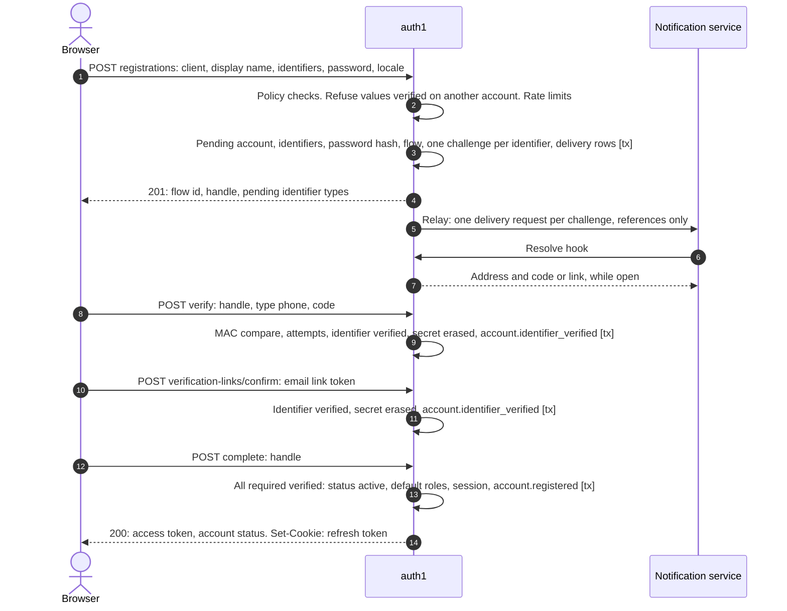
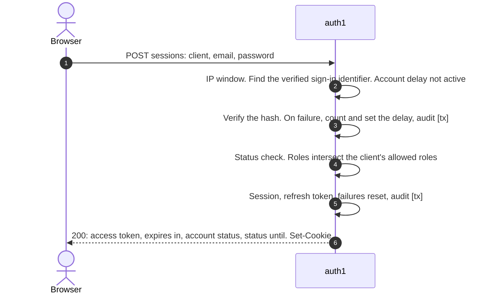
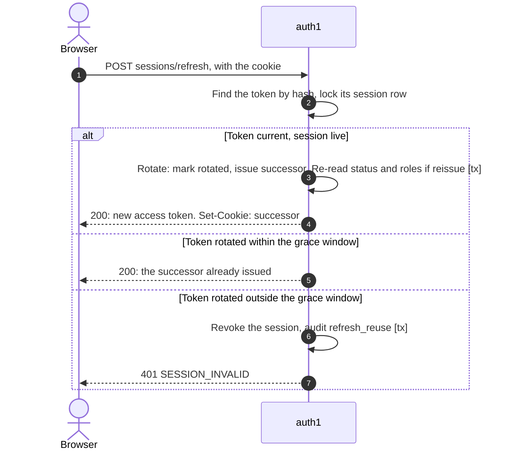
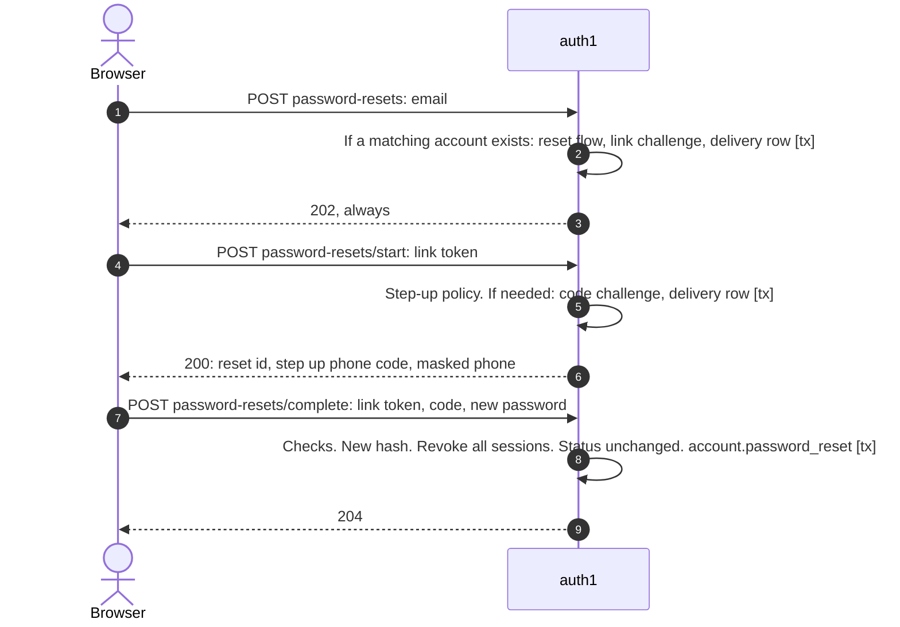
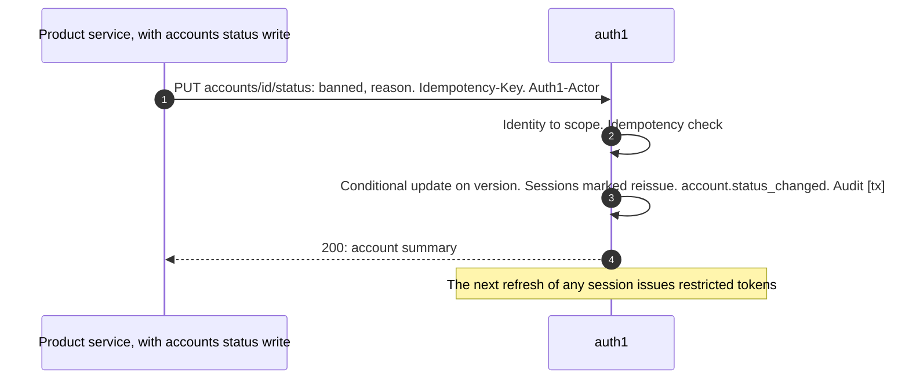
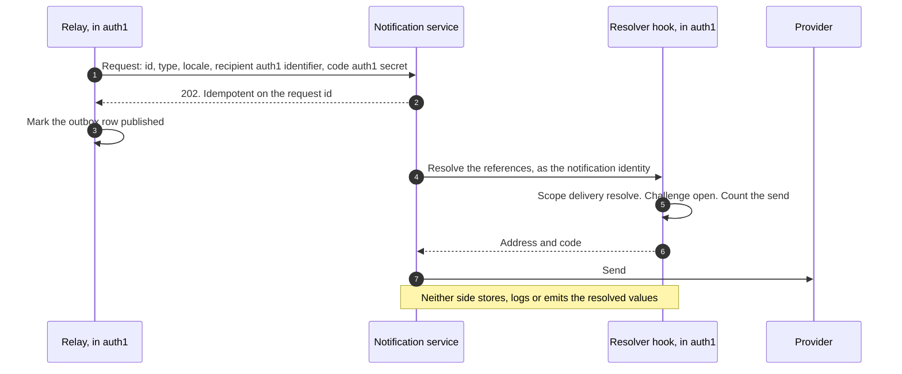

# auth1 design 1.0

| Field | Contents |
|---|---|
| Status | Draft |
| Date | 2026-10-16 |
| Owner | Arafat Hasan |
| Reviewers | The owners of each relying product's integration. For the first deployment, the reviewers of that product's identity design (its TDD-13) |
| Version | auth1 1.0. The first release governed by a published contract |
| Contracts | [`api/openapi.yaml`](../api/openapi.yaml) (OpenAPI 3.1), [`api/asyncapi.yaml`](../api/asyncapi.yaml) (AsyncAPI 3.0) |
| Inputs | The first relying product's Consumer Requirements Spec for auth1 and its change requests CR-AUTH-01…12, phrased as generic capabilities; its identity and access design (TDD-13), which states how it uses this service |
| Depends on | PostgreSQL, Redis, an AMQP 0-9-1 broker, a workload-identity source (a service mesh, or client credentials), and a message-delivery service or provider |

auth1 is an identity service: accounts, credentials, identifier verification, sessions, tokens,
account state and roles. It is **product-agnostic**. Its code knows no product. Everything that
differs between products is **deployment configuration**, and one deployment serves one product,
so auth1 has no tenant model.

The layout of this document follows the relying product's Technical Design Document template,
so the two read the same way. It is written **needs first**: §0 says what a reusable identity
service must offer, §1–§13 design auth1 from that, and only §14 compares the design with
today's code.

## Contents

0. [Needs](#0-needs)
1. [Scope and non-scope](#1-scope-and-non-scope)
2. [Traceability](#2-traceability)
3. [Principles](#3-principles)
4. [Design decisions](#4-design-decisions)
5. [Data model](#5-data-model)
6. [Contracts](#6-contracts)
7. [Behaviour](#7-behaviour)
8. [Invariants, concurrency and idempotency](#8-invariants-concurrency-and-idempotency)
9. [Failure modes](#9-failure-modes)
10. [Security and data protection](#10-security-and-data-protection)
11. [Observability](#11-observability)
12. [Configuration](#12-configuration)
13. [Testing](#13-testing)
14. [Migration and rollout](#14-migration-and-rollout)
15. [Open items](#15-open-items)
16. [Change log](#16-change-log)

## 0. Needs

What any product needs from an identity service it runs as its own, phrased generically. The
right-hand column names the relying product's requests that ask for it.

| # | Need | Requested as |
|---|---|---|
| N-1 | An account with **several identifiers** (email, phone, …), each verified on its own. Which are required, how each is verified and which can sign in are set by the deployment | CR-AUTH-01 |
| N-2 | An identifier is **unique only once verified**. A configurable policy for formats and allowed country calling codes | CR-AUTH-02 |
| N-3 | Passwords stored as adaptive hashes, with a configurable policy that includes "must not contain an identifier" | CR-AUTH-03 |
| N-4 | Sign-in methods chosen per deployment and client. Verifying an identifier by OTP is separate from signing in by OTP | CR-AUTH-04 |
| N-5 | Recovery by an emailed link, with a configurable **step-up** by a second verified factor | CR-AUTH-05 |
| N-6 | Changing an identifier safely: both addresses confirm an email change; a phone change is verified on the new number and checked for uniqueness | CR-AUTH-06 |
| N-7 | **Account states** (active, suspended until a date, banned, deleted) with reason codes, honoured by every flow, visible in tokens and introspection, with a **restricted session** so a client can explain the state | CR-AUTH-07 |
| N-8 | **Lifecycle events**, at least once, with stable ids, through an outbox to the service's own exchange, with no secrets | CR-AUTH-08 |
| N-9 | **Service callers authorised by workload identity** and scopes, with client credentials for products without a mesh. No static keys | CR-AUTH-09 |
| N-10 | A **directory** for services: batch lookup, exact search by email and phone, listing by status and role | CR-AUTH-10 |
| N-11 | A **locale** per account, and **pluggable message delivery**: through a notification service, or a provider directly | CR-AUTH-11 |
| N-12 | An **audience per client**, and **several roles** per account from a configured catalog | CR-AUTH-12 |
| N-13 | Short-lived RS256 access tokens, rotated refresh tokens, a JWKS, key rotation by `kid` | Relying product's A-8 |
| N-14 | Introspection with revocation state | A-9 |
| N-15 | Rate limits on sign-in, OTP and recovery, per account and per IP | A-13 |
| N-16 | Staff administration: inviting accounts, granting and revoking roles, closing accounts | A-12, A-15 |
| N-17 | Runs as part of the product's system: its database, broker, mesh and observability; HA; 99.9% for sign-in, refresh and JWKS | Relying product's CRS §4 |
| N-18 | Nothing product-specific in code | Relying product's platform-service rule |

## 1. Scope and non-scope

**In scope:** everything in §0, plus an optional TOTP second factor that auth1 already offers.

**Not in scope.**

| Topic | Why |
|---|---|
| Anything about the product's domain: profiles, consent, payments, sanctions as decisions | The product decides; auth1 enforces the resulting account state |
| Deciding when an account is suspended or reinstated | The product orchestrates it. auth1 records `until` for display only (D-4) |
| Templates and wording of messages | The notification service's catalog, or mounted templates for the direct adapter |
| Multi-tenancy | One deployment per product |
| OpenID Connect, social sign-in, passkeys | Not needed by any relying product yet. The token and metadata design leaves room for them |

## 2. Traceability

| Need | Satisfied by |
|---|---|
| N-1, N-2 | [D-2](#d-2-accounts-and-identifiers), [§5](#5-data-model), [§7.1](#71-registration) |
| N-3 | [D-6](#d-6-passwords) |
| N-4 | [D-5](#d-5-clients-sign-in-and-roles) |
| N-5 | [D-7](#d-7-recovery), [§7.4](#74-recovery) |
| N-6 | [D-8](#d-8-identifier-changes-and-invitations) |
| N-7 | [D-4](#d-4-account-states), [§7.5](#75-a-status-change) |
| N-8 | [D-12](#d-12-lifecycle-events) |
| N-9 | [D-10](#d-10-service-callers) |
| N-10 | [D-11](#d-11-directory-and-account-control) |
| N-11 | [D-13](#d-13-message-delivery), [§7.6](#76-delivering-a-secret) |
| N-12 | [D-5](#d-5-clients-sign-in-and-roles) |
| N-13, N-14 | [D-9](#d-9-tokens-sessions-and-keys), [§7.3](#73-refresh-and-reuse-detection) |
| N-15 | [D-14](#d-14-rate-limits-and-abuse) |
| N-16 | [D-5](#d-5-clients-sign-in-and-roles), [D-8](#d-8-identifier-changes-and-invitations), [D-11](#d-11-directory-and-account-control) |
| N-17 | [D-15](#d-15-operations), [§9](#9-failure-modes), [§11](#11-observability) |
| N-18 | [D-1](#d-1-mechanisms-in-code-policy-in-configuration) |

## 3. Principles

- **One deployment, one product.** No tenant id anywhere. Another product runs its own instance, with its own database, broker, keys and configuration.
- **Mechanisms in code, policy in configuration** (D-1).
- **Standards first:** RFC 7519 (JWT), RFC 7517 (JWK), RFC 7662 (introspection), RFC 8414 (server metadata), RFC 9457 (problem details), RFC 7523 (`private_key_jwt`), CloudEvents 1.0, NIST SP 800-63B for passwords, the OAuth 2.0 Security Best Current Practice and its browser-based-apps guidance for refresh tokens.
- **The product decides, auth1 enforces.** Sanctions, staff policy and recovery policy are decisions of the product; auth1 offers the states and switches.
- **Secrets never leave auth1** except a code or link resolved at the moment of delivery (D-13).
- **Its own data.** Its own PostgreSQL database and role; it reads nothing of the product's.
- **Integrated like the product's own services:** calls over the product's mesh, events through an outbox on its own exchange, hooks it defines.
- **Technology:** Go, Chi v5, `uptrace/bun` on PostgreSQL 16, `go-redis` v9, `amqp091-go`, OpenTelemetry. Plain SQL migrations, expand and contract.

## 4. Design decisions

### D-1. Mechanisms in code, policy in configuration

| Configuration (per deployment) | Code |
|---|---|
| Issuer URL and base path; the clients: audience, allowed roles, default roles, sign-in methods, self-registration, origins, link URLs | Token, session and key machinery |
| The identifier policy: types, required, verification method, sign-in, formats, calling codes | Normalisation, uniqueness, verification |
| The password policy; the deny-list file | Hashing, checks |
| The role catalog; revoke sessions on role removal; bootstrap admins | Roles and the client intersection |
| The status reason codes | The state machine |
| Lifetimes, OTP length and attempts, rate limits | Their enforcement |
| The delivery adapter, message types, locales; templates for the direct adapter | Challenges, the resolver hook, adapters |
| The service callers and their scopes; client credentials | Scope enforcement |
| The event exchange and `source` | Outbox and relay |

**A guard in CI.** A test scans the code, the default configuration and the migrations for a
configured list of product words, and fails on any match. Product values never enter this
repository; each product keeps its configuration in its own repository.

### D-2. Accounts and identifiers

- An **account** has an id (UUID v4), a status, a display name, a locale, a version and timestamps.
- An **identifier** is a row: type (from the policy), the normalised value, a verification time, and whether it is still current. An account has at most one current identifier per type.
- **Uniqueness applies to verified, current identifiers only**: a partial unique index on `(type, blind index)`. An unverified value never blocks another account. Two accounts racing to verify the same value: the unique index settles it, and the loser gets `IDENTIFIER_TAKEN`.
- **Normalisation.** Email: trimmed, lower-cased, Unicode NFC; no provider-specific folding. Phone: parsed to E.164 with libphonenumber; refused unless its calling code is in the policy's list and its national number matches the policy's length.
- **Storage.** The value is encrypted per field (AES-256-GCM, key id in the ciphertext). Lookups use a blind index: HMAC-SHA256 of the normalised value under a separate key.

**Identifier policy** (example for a product that needs email and phone):

```yaml
identifiers:
  email: { required: true, verify: email_link, sign_in: true }
  phone: { required: true, verify: sms_otp, sign_in: false,
           calling_codes: ["+<cc>"], national_digits: 10 }
```

### D-3. Flows and challenges

Every multi-step interaction is a **flow**: registration, password reset, email change, phone
change, invitation. A flow has a kind, an account, a client, a handle and an expiry. The browser
holds the flow's **handle**, an opaque 256-bit value whose hash auth1 stores.

A flow owns **challenges**: one per secret auth1 sends. A challenge has a purpose, a method
(`sms_otp`, `email_link`, `email_code`), a target identifier (or, for a change, the encrypted new
value), the secret's HMAC, an attempt counter, a send counter and an expiry. While it is open, it
also holds the secret **encrypted**, so that it can be resolved at delivery time (D-13). When it
is used or expires, the encrypted secret is erased.

- OTP: 6 digits *(cfg)*, from a CSPRNG. Verified by comparing HMAC-SHA256 under a server key, in constant time. A plain hash of six digits could be reversed offline; a keyed one cannot.
- Link token: 256 bits, base64url. Stored as SHA-256.

### D-4. Account states

States: `pending`, `active`, `suspended`, `banned`, `deleted`. `suspended` and `banned` carry a
`reason_code` from the configured list; `suspended` may carry `until`.

| Flow | `pending` | `active` | `suspended`, `banned` | `deleted` |
|---|---|---|---|---|
| Sign in | `REGISTRATION_INCOMPLETE` | Session | **Restricted session** *(cfg: or `ACCOUNT_RESTRICTED`)* | `INVALID_CREDENTIALS` (neutral) |
| Refresh | — | Tokens | Restricted tokens | Refused; sessions revoked |
| Password reset | — | Allowed | Allowed; status unchanged | Nothing sent; 202 as always |
| Identifier change, TOTP changes | — | Allowed | `ACCOUNT_RESTRICTED` | — |
| Introspection | — | Active, `status: active` | Active, `status` as stored | Inactive |

- **Restricted session.** Tokens carry `status` not equal to `active`. auth1 itself accepts them only on `GET /v1/me`, the session list and sign-out. Relying services refuse them. The token response carries `account_status` and `status_until`, so a client can explain the state. Whether a fresh sign-in gets one is configuration (`statuses.restricted_sign_in`).
- **A status change** marks every session of the account `reissue`: the next refresh issues tokens with the new status and roles. Access tokens already issued live until they expire.
- **`until` is information only.** auth1 never changes a status on a timer. A product that wants automatic reinstatement runs it where it decides sanctions, and calls account control.
- **Deletion** revokes every session, erases the password hash and TOTP secret, and releases the identifiers from uniqueness. The account row and identifiers remain, encrypted, for audit (retention: D-15).
- **Version.** Every change to an account's status, roles, identifiers or credentials increments `accounts.version`. Events carry it (D-12).

### D-5. Clients, sign-in and roles

A **client** is a relying-party application (a browser app, a console). Per client:

| Setting | Meaning |
|---|---|
| `id` | Sent by the browser on sign-in and registration |
| `audience` | The `aud` of tokens issued to it |
| `allowed_roles` | Roles that may appear in its tokens. Token roles = account roles ∩ allowed roles. If the intersection is empty, sign-in is refused with `ROLE_NOT_PERMITTED` |
| `default_roles` | Given to accounts that register through it |
| `sign_in` | `[password]`, `[password, otp]`, `[otp]` |
| `self_registration` | Whether it may start registrations. Otherwise accounts arrive by invitation |
| `mfa` | `off`, `optional`, `required` (TOTP) |
| `origins`, `link_base_url` | Allowed origins; the base URL the emailed links point to |

**Roles** come from a configured catalog. An account holds a set. auth1 knows no hierarchy: a
product that wants one applies it when it reads the token. When a role is removed, auth1 revokes
the account's sessions *(cfg: `roles.revoke_sessions_on_removal`)*.

**Sign-in** by password (and, where a client allows it, by an OTP sent to a sign-in identifier).
OTP *verification* of a phone exists whether or not OTP *sign-in* is allowed: they are different
challenge purposes.

### D-6. Passwords

- Length 8 to 128 characters *(cfg)*. No composition rules.
- Refused if it equals or contains, case-insensitively, any current identifier of the account or the registration (an email, its local part, a phone in E.164 or national form), or appears in the deny-list.
- Hash: bcrypt, cost 12 *(cfg; refused below 12)*, applied to base64(SHA-256(password)) so passwords over 72 bytes are not truncated. Stored as a PHC string (`$bcrypt-sha256$v=2,t=2b,r=12$…`). Verification rehashes on sign-in when the stored parameters are below the configured ones.
- A password change requires the current password, revokes every other session, and emits `account.password_changed`.

### D-7. Recovery

1. `POST /v1/password-resets` with an email. Always 202. If a current, verified email identifier matches an account that is not `deleted` or `pending`, auth1 opens a reset flow and sends `password_reset_link`.
2. The link opens the client's page, which calls `POST /v1/password-resets/start` with the token. auth1 answers whether a **step-up** is needed and, if so, sends `password_reset_code` by SMS and returns the masked phone.
3. `POST /v1/password-resets/{id}/complete` with the token, the code if required, and the new password. auth1 checks the policy, stores the new hash, revokes every session, leaves the status unchanged, and emits `account.password_reset`.

**Step-up policy** *(cfg: `recovery.step_up`)*: `always` (whenever the account has a verified
phone), `by_attribute` (when a trusted service has set the account attribute `recovery_step_up`
through account control), or `never`.

### D-8. Identifier changes and invitations

- **Email change.** Needs the current password. auth1 refuses a value that is another account's verified email, then sends `email_change_confirm_old` to the current address and `email_change_confirm_new` to the new one. The change applies when both are confirmed: the old identifier stops being current, the new one is current and verified, and `account.identifier_changed` is emitted.
- **Phone change.** Needs the current password. An OTP goes to the new number (`phone_change_code`); on success, uniqueness is checked by the index and the swap applies.
- **Invitation.** A service with `accounts:invite` invites an email with a display name, a client and roles. auth1 creates a `pending` account with that email (to be verified by the invitation link), the roles, and sends `invitation_link`. Following the link and setting a password verifies the email and activates the account. Invitations expire after 72 h *(cfg)*.
- **Bootstrap.** If no account holds a role listed in `bootstrap.roles` (for example the product's administrator role), auth1 invites each email in `bootstrap.emails` with that role at start-up. It does nothing once one exists.

### D-9. Tokens, sessions and keys

**Access token.** JWT, RS256, `typ: at+jwt` (RFC 9068), 15 minutes *(cfg; refused above 15)*.

| Claim | Value |
|---|---|
| `iss` | The configured issuer URL |
| `sub` | The account id |
| `aud` | The client's audience |
| `exp`, `iat`, `nbf`, `jti` | Standard |
| `sid` | The session id |
| `client_id` | The client |
| `roles` | Account roles ∩ the client's allowed roles |
| `status` | The account status |
| `amr` | `["pwd"]`, `["pwd","otp"]` or `["otp"]` (RFC 8176) |

No email, phone or name: tokens are cached by browsers and logged by proxies.

**Sessions and refresh tokens.**

- A session is created at sign-in, per client. It has an idle expiry (7 days *(cfg)*), an absolute expiry (30 days *(cfg)*), a `reissue` flag and a revocation time.
- Refresh tokens are opaque 256-bit values, stored as SHA-256, chained per session. Each use rotates: the presented token is marked rotated and a successor issued.
- **Reuse detection.** A rotated token presented again after the grace window (10 s *(cfg)*) revokes the session and is audited. Inside the window, auth1 returns the successor already issued, so two tabs refreshing at once do not sign the member out.
- **Transport.** For a browser client, the refresh token is set in an `HttpOnly`, `Secure`, `SameSite=Strict` cookie whose path is auth1's session path. A non-browser client may receive it in the body *(cfg per client)*.
- **Revocation.** Sign-out revokes the session. A password change or reset revokes all of them. A deletion revokes all of them. A status or role change marks them `reissue` (and a role removal can revoke them, D-5).

**Signing keys.** A keyring of RSA keys (2048 bits *(cfg: 3072)*), loaded from a mounted secret.
Each key has a `kid` (the RFC 7638 thumbprint) and a state:

| State | In the JWKS | Signs |
|---|---|---|
| `next` | Yes | No |
| `active` | Yes | Yes. Exactly one |
| `retired` | Yes, until `retired_at` + the access-token lifetime + 5 min | No |

A rotation is a configuration change: add a `next` key; after at least the relying services'
JWKS refresh interval (configured as `keys.min_publish_before_use`, default 15 min), promote it
to `active`, which retires the previous one. auth1 refuses to promote a key that has not been
published for that long. The keyring is re-read on change without a restart.

**Introspection** (RFC 7662, `tokens:introspect`). `active` is false if the signature, expiry,
issuer or audience fails, the session is revoked or expired, or the account is deleted. Otherwise
it returns `sub`, `aud`, `sid`, `client_id`, `roles`, `status`, `exp`, `iat`, `jti`.

**Metadata.** `/.well-known/jwks.json` (cacheable 5 min) and
`/.well-known/oauth-authorization-server` (issuer, JWKS URI, introspection and token endpoints).

### D-10. Service callers

- **Mesh mode.** auth1 reads the caller's workload identity from a configured source: a header set by the local sidecar (`X-Forwarded-Client-Cert` with its `URI=` element, or a plain header such as `l5d-client-id`), accepted only from the sidecar's address; or the verified peer certificate's URI SAN when auth1 terminates mTLS itself.
- **Client-credentials mode.** `POST /v1/oauth/token` with `grant_type=client_credentials` and a `private_key_jwt` client assertion (RFC 7523). The resulting token's `aud` is auth1 itself, and its `scope` lists the granted scopes. For products without a mesh.
- **Scopes.** Configuration maps each identity (a SPIFFE id, or a client id) to scopes:

| Scope | Grants |
|---|---|
| `tokens:introspect` | Introspection |
| `directory:read` | Batch get, search, list |
| `accounts:status:write` | Status changes; revoking an account's sessions; setting `recovery_step_up` |
| `accounts:roles:write` | Setting roles |
| `accounts:invite` | Invitations |
| `accounts:delete` | Closing an account |
| `delivery:resolve` | The delivery resolver hook (D-13) |

- No static API key exists. If `service_auth.mode` is not configured, auth1 refuses to start outside `development`.

### D-11. Directory and account control

**Directory** (`directory:read`). Batch get (up to 100 ids), search (exactly one of email or phone,
exact match on the normalised value, current verified identifiers only; a `POST`, so values never
appear in a URL), list (filters on status, role and creation time; cursor pagination, 20 per page,
at most 100). A record: id, display name, status, `status_until`, roles, locale, `created_at`, and
the current identifiers with type, value and `verified_at`. Deleted accounts appear only with
`include_deleted`. Each call is audited with the caller, the acting person if the caller names one
in `Auth1-Actor`, the operation and the result count, never the values.

**Account control.** Each write requires an `Idempotency-Key`; auth1 stores the key with the
caller, a hash of the request and the response for 24 h *(cfg)*, and replays the response on a
retry (a different request with the same key is `IDEMPOTENCY_KEY_REUSED`). Each names the acting
person in `Auth1-Actor` when there is one, for the audit and the event's `actor`.

| Operation | Scope | Effect |
|---|---|---|
| `PUT /v1/accounts/{id}/status` | `accounts:status:write` | D-4. `reason_code` required for `suspended` and `banned`; `until` only for `suspended`. Refused for `pending` and `deleted` accounts |
| `POST /v1/accounts/{id}/sessions/revoke` | `accounts:status:write` | Revokes every session |
| `PUT /v1/accounts/{id}/attributes` | `accounts:status:write` | Sets `recovery_step_up` (for `by_attribute`) |
| `PUT /v1/accounts/{id}/roles` | `accounts:roles:write` | Replaces the role set; every role must be in the catalog |
| `POST /v1/invitations` | `accounts:invite` | D-8 |
| `DELETE /v1/accounts/{id}` | `accounts:delete` | D-4 deletion |

### D-12. Lifecycle events

**Envelope: CloudEvents 1.0, structured JSON mode, over AMQP.** auth1 writes each event to its
outbox in the transaction that makes the change. The relay publishes to the configured topic
exchange (default `auth1.events`), routing key = `type`, with publisher confirms; AMQP
`message_id` = `id` and `content_type` = `application/cloudevents+json`.

| Attribute | Value |
|---|---|
| `specversion` | `1.0` |
| `id` | UUIDv7, stable per outbox row. Consumers deduplicate on it |
| `source` | Configured, default `/auth1` |
| `type` | The event type below |
| `subject` | The account id |
| `time` | The commit time, RFC 3339 UTC |
| `datacontenttype` | `application/json` |
| `dataversion` | Extension. Integer version of `data`'s schema, from 1 |
| `accountversion` | Extension. `accounts.version` after the change, for consumers that keep state |
| `traceparent`, `tracestate` | Extension (CloudEvents distributed tracing) |

**Types.** `account.registered`, `account.identifier_verified`, `account.identifier_changed`,
`account.password_changed`, `account.password_reset`, `account.status_changed`,
`account.roles_changed`, `account.deleted`. Their `data` schemas are in the AsyncAPI document.
**No identifier value and no secret ever appears in `data`**; consumers that need a value use the
directory.

**Delivery.** At least once, in outbox order per relay. A relay instance runs on every replica;
rows are claimed with `FOR UPDATE SKIP LOCKED` in id order per account (a row is claimed only if no
earlier unsent row for the same subject exists), so one account's events are published in order.
Published rows are kept 7 days *(cfg)*.

**Compatibility.** Within `dataversion`, changes are additive only. A breaking change publishes
both versions until consumers have moved, and is announced one release ahead.

### D-13. Message delivery

A **`MessageDelivery` port** with three adapters, chosen by `delivery.adapter`:

| Adapter | How | For |
|---|---|---|
| `notification` | auth1 submits a request holding **references only** to a notification service; that service calls auth1's **resolver hook** at send time for the address and the secret | Products that run a notification service, so all their messages share preferences, templates, providers and delivery tracking |
| `direct` | auth1 renders a mounted template and calls an SMTP server or an HTTP SMS provider itself | Products without one; a stopgap |
| `capture` | Writes messages to an in-memory inbox readable at `GET /dev/messages` | `development` only; refused elsewhere |

**The `notification` adapter.**

1. The flow writes the challenge, then a delivery row to the outbox, in one transaction. The row holds: `request_id` = `<challenge id>:<send number>`, the message `type` (configured per purpose), the `locale`, the recipient `auth1:identifier:<id>` or, for a change, `auth1:challenge-target:<challenge id>`, and the variable `code` or `link` as `auth1:secret:<challenge id>`.
2. The relay `POST`s it to the configured request endpoint over the mesh, idempotent on `request_id`.
3. The notification service calls `POST /v1/hooks/delivery/resolve` (`delivery:resolve`) with the references. auth1 returns each value **only if its challenge is open** (not used, not expired, sends not exhausted). A closed challenge resolves to nothing, and the delivery is dropped.
4. Nothing resolved is stored, logged or put in an event by either side.

**Message types and purposes** (the type names are configuration):

| Purpose | Default type | Channel | Variables |
|---|---|---|---|
| Phone verification | `auth.phone_verification_code` | SMS | `code` |
| Email verification | `auth.email_verification_link` | Email | `link` |
| Reset link | `auth.password_reset_link` | Email | `link` |
| Reset step-up | `auth.password_reset_code` | SMS | `code` |
| Email change, old address | `auth.email_change_confirm_old` | Email | `link` |
| Email change, new address | `auth.email_change_confirm_new` | Email | `link` |
| Phone change | `auth.phone_change_code` | SMS | `code` |
| Invitation | `auth.invitation_link` | Email | `link` |
| Sign-in OTP (if a client allows it) | `auth.sign_in_code` | SMS or email | `code` |

**Locale.** Each account has a locale from `locales.allowed` (default `locales.default`), set at
registration from the request and changeable through `PATCH /v1/me`. Every delivery request
carries it.

### D-14. Rate limits and abuse

| Control | Key | Store | Default *(cfg)* | On store failure |
|---|---|---|---|---|
| Failed sign-ins | Account | PostgreSQL (`accounts.failed_sign_ins`, `sign_in_delay_until`) | After 5 failures, a delay that doubles from 1 s to 15 min; reset on success | Not applicable |
| Sign-in attempts | IP | Redis sliding window | 30 per 5 min | Fail open, alert |
| OTP verification | Challenge | PostgreSQL (`attempts`) | 3 per code, then the challenge closes and a 15-minute cooldown applies to new sends for that target | Not applicable |
| OTP sends | Target identifier | PostgreSQL (`sends`, `last_sent_at`) | One per 60 s; 5 per hour | Not applicable |
| OTP sends, reset requests, registrations | IP | Redis | 20, 10, 5 per hour | Fail open, alert |
| Reset requests | Account | PostgreSQL | 3 per hour | Not applicable |
| Global | IP | Redis | 600 per minute | Fail open, alert |

The per-account and per-challenge controls are in PostgreSQL, so losing Redis never weakens
them. A hard lockout is not used: it would let anyone lock a member out.

### D-15. Operations

| Aspect | Rule |
|---|---|
| Availability | 99.9% a month for sign-in, refresh and the JWKS. At least 2 replicas across nodes, a pod disruption budget of 1, stateless apart from PostgreSQL |
| Latency | Sign-in under 500 ms at p95 (bcrypt cost 12 dominates). Introspection under 100 ms at p95. JWKS under 200 ms |
| Scaling | CPU-bound on bcrypt. Sized at 1 core per 4 sign-ins a second, plus headroom *(to measure)* |
| Database | Its own database and role. Migrations as a separate binary, run as a pre-deploy job. Expand and contract only |
| Secrets | Signing keys, field-encryption keys, the blind-index key, the OTP HMAC key, provider credentials: from mounted secrets. Never in configuration files in git |
| Health | `/livez` (process), `/readyz` (PostgreSQL, keys loaded; Redis and the broker are reported but do not fail readiness) |
| Retention *(cfg)* | Pending registrations: purged 7 days after expiry. Closed challenges: 30 days. Revoked sessions and their refresh tokens: 90 days. Idempotency keys: 24 h. Published outbox rows: 7 days. `auth_audit`: kept; a product sets a horizon if its law requires one. Deleted accounts: kept, encrypted, released from uniqueness; erasure on a product's request is an operator command |
| Jobs | Purging and the outbox relay. Purge jobs elect one leader with a PostgreSQL advisory lock |

## 5. Data model

PostgreSQL 16, one database owned by auth1's role. Migrations are plain SQL, numbered
`000NNN_<name>.up.sql` / `.down.sql` in `migrations/`, applied by the migration binary; the
numbering restarts at `000001` for 1.0 (§14). `bytea` columns marked *enc* hold AES-256-GCM
ciphertext prefixed with the key id; *bidx* columns hold HMAC-SHA256 blind indexes.

```sql
CREATE TABLE accounts (
    id                  uuid PRIMARY KEY,
    status              text NOT NULL CHECK (status IN ('pending','active','suspended','banned','deleted')),
    status_reason       text,
    status_until        timestamptz,
    status_changed_at   timestamptz NOT NULL DEFAULT now(),
    display_name        bytea NOT NULL,                 -- enc
    locale              text NOT NULL,
    registered_via      text NOT NULL,                  -- client id, or 'invitation'
    recovery_step_up    boolean NOT NULL DEFAULT false, -- for recovery.step_up = by_attribute
    failed_sign_ins     integer NOT NULL DEFAULT 0,
    sign_in_delay_until timestamptz,
    version             bigint NOT NULL DEFAULT 1,
    created_at          timestamptz NOT NULL DEFAULT now(),
    updated_at          timestamptz NOT NULL DEFAULT now(),
    CHECK (status_until IS NULL OR status = 'suspended'),
    CHECK ((status IN ('suspended','banned')) = (status_reason IS NOT NULL))
);
CREATE INDEX accounts_status ON accounts (status, created_at);

CREATE TABLE identifiers (
    id           uuid PRIMARY KEY,
    account_id   uuid NOT NULL REFERENCES accounts (id),
    type         text NOT NULL,
    value        bytea NOT NULL,                        -- enc, normalised
    value_bidx   bytea NOT NULL,                        -- bidx of (type, normalised value)
    verified_at  timestamptz,
    retired_at   timestamptz,                           -- replaced by a change, or released on deletion
    created_at   timestamptz NOT NULL DEFAULT now()
);
CREATE UNIQUE INDEX identifiers_verified_unique ON identifiers (type, value_bidx)
    WHERE verified_at IS NOT NULL AND retired_at IS NULL;
CREATE UNIQUE INDEX identifiers_current_per_type ON identifiers (account_id, type)
    WHERE retired_at IS NULL;
CREATE INDEX identifiers_lookup ON identifiers (type, value_bidx) WHERE retired_at IS NULL;

CREATE TABLE password_credentials (
    account_id  uuid PRIMARY KEY REFERENCES accounts (id),
    hash        text NOT NULL,                          -- PHC string
    changed_at  timestamptz NOT NULL DEFAULT now()
);

CREATE TABLE totp_factors (
    account_id   uuid PRIMARY KEY REFERENCES accounts (id),
    secret       bytea NOT NULL,                        -- enc
    confirmed_at timestamptz,
    last_step    bigint                                 -- replay protection
);

CREATE TABLE account_roles (
    account_id  uuid NOT NULL REFERENCES accounts (id),
    role        text NOT NULL,
    granted_at  timestamptz NOT NULL DEFAULT now(),
    granted_by  text,                                   -- actor
    PRIMARY KEY (account_id, role)
);
CREATE INDEX account_roles_role ON account_roles (role);

CREATE TABLE flows (
    id            uuid PRIMARY KEY,
    kind          text NOT NULL CHECK (kind IN ('registration','password_reset','email_change','phone_change','invitation','sign_in_otp')),
    account_id    uuid NOT NULL REFERENCES accounts (id),
    client_id     text NOT NULL,
    handle_hash   bytea UNIQUE,                         -- sha256 of the browser's handle
    expires_at    timestamptz NOT NULL,
    completed_at  timestamptz,
    cancelled_at  timestamptz,
    created_at    timestamptz NOT NULL DEFAULT now()
);
CREATE INDEX flows_account ON flows (account_id, kind) WHERE completed_at IS NULL AND cancelled_at IS NULL;

CREATE TABLE challenges (
    id             uuid PRIMARY KEY,
    flow_id        uuid NOT NULL REFERENCES flows (id),
    purpose        text NOT NULL,                       -- verify_identifier, reset_link, reset_step_up, confirm_old, confirm_new, invitation, sign_in
    method         text NOT NULL CHECK (method IN ('sms_otp','email_link','email_code')),
    identifier_id  uuid REFERENCES identifiers (id),    -- the target, when it exists
    target_value   bytea,                               -- enc: the new value of a change
    target_bidx    bytea,
    secret_mac     bytea NOT NULL,                      -- HMAC (OTP) or SHA-256 (link token)
    secret         bytea,                               -- enc; erased when closed
    attempts       integer NOT NULL DEFAULT 0,
    max_attempts   integer NOT NULL,
    sends          integer NOT NULL DEFAULT 0,
    last_sent_at   timestamptz,
    expires_at     timestamptz NOT NULL,
    consumed_at    timestamptz,
    closed_at      timestamptz,                         -- consumed, exhausted or expired
    created_at     timestamptz NOT NULL DEFAULT now(),
    CHECK (identifier_id IS NOT NULL OR target_value IS NOT NULL),
    CHECK (closed_at IS NULL OR secret IS NULL)
);
CREATE UNIQUE INDEX challenges_secret_mac ON challenges (secret_mac) WHERE method = 'email_link';
CREATE INDEX challenges_open ON challenges (expires_at) WHERE closed_at IS NULL;

CREATE TABLE sessions (
    id                   uuid PRIMARY KEY,
    account_id           uuid NOT NULL REFERENCES accounts (id),
    client_id            text NOT NULL,
    amr                  text[] NOT NULL,
    created_at           timestamptz NOT NULL DEFAULT now(),
    last_used_at         timestamptz NOT NULL DEFAULT now(),
    idle_expires_at      timestamptz NOT NULL,
    absolute_expires_at  timestamptz NOT NULL,
    reissue              boolean NOT NULL DEFAULT false,
    revoked_at           timestamptz,
    revoke_reason        text,
    user_agent           text
);
CREATE INDEX sessions_account ON sessions (account_id) WHERE revoked_at IS NULL;

CREATE TABLE refresh_tokens (
    token_hash      bytea PRIMARY KEY,                  -- sha256
    session_id      uuid NOT NULL REFERENCES sessions (id),
    issued_at       timestamptz NOT NULL DEFAULT now(),
    rotated_at      timestamptz,
    successor_hash  bytea
);
CREATE INDEX refresh_tokens_session ON refresh_tokens (session_id);

CREATE TABLE idempotency_keys (
    caller        text NOT NULL,
    key           text NOT NULL,
    request_hash  bytea NOT NULL,
    status        integer NOT NULL,
    response      jsonb NOT NULL,
    created_at    timestamptz NOT NULL DEFAULT now(),
    PRIMARY KEY (caller, key)
);

CREATE TABLE auth_audit (
    id          bigint GENERATED ALWAYS AS IDENTITY PRIMARY KEY,
    at          timestamptz NOT NULL DEFAULT now(),
    account_id  uuid,
    actor_kind  text NOT NULL CHECK (actor_kind IN ('account','service','system','anonymous')),
    actor_id    text,
    action      text NOT NULL,                          -- sign_in, sign_in_failed, refresh_reuse, reset_completed, directory_search, ...
    outcome     text NOT NULL,
    client_id   text,
    ip          inet,
    user_agent  text,
    details     jsonb NOT NULL DEFAULT '{}'             -- never a secret or an identifier value
);
CREATE INDEX auth_audit_account ON auth_audit (account_id, at);
-- auth1's role has INSERT and SELECT on auth_audit, and no UPDATE, DELETE or TRUNCATE.

CREATE TABLE outbox (
    id               uuid PRIMARY KEY,                  -- UUIDv7; the CloudEvents id for events
    destination      text NOT NULL CHECK (destination IN ('event','delivery')),
    subject          uuid,                              -- account id, for per-account order
    type             text NOT NULL,
    body             jsonb NOT NULL,                    -- event data, or the delivery request
    trace_context    jsonb,
    created_at       timestamptz NOT NULL DEFAULT now(),
    attempts         integer NOT NULL DEFAULT 0,
    next_attempt_at  timestamptz NOT NULL DEFAULT now(),
    published_at     timestamptz,
    last_error       text
);
CREATE INDEX outbox_pending ON outbox (next_attempt_at) WHERE published_at IS NULL;
```

**Redis** (prefix configurable): `rl:<rule>:<key>` sorted sets for the per-IP windows. Nothing else.

## 6. Contracts

| File | Contents |
|---|---|
| [`api/openapi.yaml`](../api/openapi.yaml) | Every HTTP endpoint: public flows, `/v1/me`, metadata and JWKS, service APIs, the resolver hook, the client-credentials token endpoint; and, as a webhook, the delivery request auth1 sends. The health probes are operational and not part of the contract |
| [`api/asyncapi.yaml`](../api/asyncapi.yaml) | The lifecycle events on the events exchange, as CloudEvents |

**Base path.** Every path is served under `http.base_path` *(cfg, default empty)*, so a product's
edge can route a prefix to auth1 without rewriting.

**Errors** are RFC 9457 problem details (`application/problem+json`) with a stable `code`:

| Code | HTTP | Meaning | Retryable |
|---|---|---|---|
| `VALIDATION_FAILED` | 422 | A field is malformed; `errors` lists each | No |
| `IDENTIFIER_NOT_ALLOWED` | 422 | The identifier fails the policy (format, calling code) | No |
| `PASSWORD_REJECTED` | 422 | The password fails the policy; `reasons` says why | No |
| `IDENTIFIER_TAKEN` | 409 | The value is another account's verified identifier | No |
| `VERIFICATION_INCOMPLETE` | 409 | A registration was completed before every required identifier was verified | No |
| `CODE_INVALID` | 400 | Wrong code; `attempts_left` | No |
| `CHALLENGE_CLOSED` | 410 | The code or link is used, expired or out of attempts | No. Start again |
| `RESEND_TOO_SOON` | 429 | A new code was asked for before `retry_after` | Yes, after `retry_after` |
| `INVALID_CREDENTIALS` | 401 | Wrong email or password, or a deleted account | No |
| `SIGN_IN_DELAYED` | 429 | Too many failures; `retry_after` | Yes, after `retry_after` |
| `REGISTRATION_INCOMPLETE` | 403 | The account is still `pending` | No |
| `ROLE_NOT_PERMITTED` | 403 | The account holds none of the client's allowed roles | No |
| `ACCOUNT_RESTRICTED` | 403 | The operation is not available to a suspended or banned account | No |
| `MFA_REQUIRED` | 202 | Not an error: the sign-in needs a TOTP code; `mfa_token` | — |
| `SESSION_INVALID` | 401 | The refresh token is unknown, expired, rotated or its session revoked | No. Sign in again |
| `TOKEN_INVALID` | 401 | A bearer token on an auth1 endpoint is invalid | No |
| `REAUTHENTICATION_REQUIRED` | 403 | The current password is missing or wrong on a sensitive change | No |
| `CALLER_NOT_ALLOWED` | 403 | The workload identity or client lacks the scope | No |
| `IDEMPOTENCY_KEY_REUSED` | 422 | The key was used for a different request | No |
| `STATUS_TRANSITION_INVALID` | 409 | For example, suspending a `pending` or `deleted` account | No |
| `ROLE_UNKNOWN` | 422 | A role outside the catalog | No |
| `NOT_FOUND` | 404 | The account or flow does not exist | No |
| `RATE_LIMITED` | 429 | A per-IP limit; `retry_after` | Yes |
| `UNAVAILABLE` | 503 | A dependency is down | Yes |

## 7. Behaviour

`[tx]` marks one PostgreSQL transaction, which includes its outbox rows.

### 7.1 Registration



A registration whose values collide at verification (another account verified the same value
first) gets `IDENTIFIER_TAKEN` on the verify call and must use another value.

### 7.2 Sign-in



If the client requires TOTP, step 5 returns 202 `MFA_REQUIRED` with a short-lived `mfa_token`,
and `POST /v1/sessions/mfa` with the code completes it.

### 7.3 Refresh and reuse detection



### 7.4 Recovery



### 7.5 A status change



### 7.6 Delivering a secret



### 7.7 Key rotation

1. An operator adds key K2 with state `next` to the keyring secret. auth1 reloads it and publishes K2 in the JWKS.
2. After `keys.min_publish_before_use`, the operator sets K2 `active`. auth1 refuses if K2 has not been published that long. K1 becomes `retired` and stops signing.
3. auth1 drops K1 from the JWKS once the access-token lifetime plus 5 minutes has passed since it retired. The operator then removes it from the secret.

**A leaked key** skips the waiting: K2 becomes `active` at once, K1 is removed, and
`POST /v1/accounts/{id}/sessions/revoke` is not needed per account because an operator command
(`auth1 sessions revoke-all`) marks every session revoked. Relying services refuse K1 tokens at
their next JWKS refresh.

## 8. Invariants, concurrency and idempotency

| # | Invariant | Enforced by |
|---|---|---|
| I-1 | A verified, current identifier value belongs to one account | `identifiers_verified_unique` |
| I-2 | An account has at most one current identifier per type | `identifiers_current_per_type` |
| I-3 | A refresh token rotates once | `UPDATE refresh_tokens SET rotated_at = now() … WHERE token_hash = $1 AND rotated_at IS NULL`, under the session row lock |
| I-4 | A challenge accepts at most `max_attempts` tries and is consumed once | Conditional update on `attempts` and `closed_at` |
| I-5 | A closed challenge holds no secret | `CHECK (closed_at IS NULL OR secret IS NULL)` |
| I-6 | Exactly one signing key is `active` | Keyring validation at load; auth1 refuses to start otherwise |
| I-7 | An event and the change it reports commit together | The outbox row in the same transaction |
| I-8 | One account's events are published in order | The relay's per-subject claim rule (D-12) |
| I-9 | An account-control write applies once per `Idempotency-Key` | `idempotency_keys` primary key, written in the same transaction |
| I-10 | Status and role changes apply in order | `UPDATE accounts … WHERE id = $1 AND version = $2` |
| I-11 | `auth_audit` is never altered | Grants |

## 9. Failure modes

| Failure | Detected by | Behaviour | Recovery | Alert |
|---|---|---|---|---|
| PostgreSQL down | Readiness | Not ready: no sign-in, refresh or JWKS from this replica. Tokens already issued work at relying services until they expire | Automatic | Yes |
| Redis down | Health detail | Per-IP limits fail open. Everything else works | Automatic | Yes |
| Broker down | Relay errors, outbox age | Events wait in the outbox | Automatic | Yes, on outbox age |
| Notification service down | Relay errors | Delivery requests wait and are retried within each challenge's validity. A request older than its challenge is dropped | Automatic | Yes, on delivery outbox age above 30 s |
| Resolver hook unreachable from the notification service | That service's retries | Deliveries wait | Automatic | At the notification service |
| Keyring secret invalid on reload | Validation | The previous keyring stays in use | Fix the secret | Yes |
| Clock skew | `nbf` failures at relying services | Leeway at the relying services | NTP | Node alert |
| bcrypt saturating CPU | Sign-in latency | Horizontal scaling on CPU | Automatic | Yes, on p95 |

## 10. Security and data protection

| Topic | Rule |
|---|---|
| Classes | Secret: passwords, OTPs, link tokens, refresh tokens, TOTP secrets, keys. Personal: identifier values, display name, IP addresses in the audit |
| At rest | Identifier values, display names and TOTP secrets encrypted per field. Volumes and backups encrypted by the platform |
| In transit | TLS on every hop: the mesh's mTLS between services; TLS to PostgreSQL, Redis and the broker |
| Logs | Structured JSON. Redacted: `Authorization`, cookies, any field named `password`, `code`, `token`, `secret`, `email`, `phone`. Identifier values never logged, not even masked |
| Events | Ids and codes only (D-12) |
| Browser | Refresh cookie `HttpOnly`, `Secure`, `SameSite=Strict`, path-scoped. State-changing browser endpoints accept only `application/json`, and check `Origin` against the client's origins |
| Enumeration | Reset requests answer 202 always. Sign-in failures say `INVALID_CREDENTIALS` whatever failed. Registration reveals a taken identifier only because products require it; per-IP limits slow harvesting |
| Timing | Constant-time comparison of codes and MACs. Sign-in with an unknown email still runs a dummy bcrypt |
| Service auth | No static keys. Scopes per identity (D-10) |
| Development | `capture` delivery and any development shortcut are refused unless `app.environment` is `development` |

## 11. Observability

OpenTelemetry for traces and metrics; JSON logs with `ts`, `level`, `service`, `trace_id`,
`request_id`, `account_id`, `client_id`, `caller`, `event`, `error`.

| Metric | Labels |
|---|---|
| `auth1_sign_ins_total` | `client`, `result` (`ok`, `restricted`, `invalid`, `delayed`, `pending`, `role`) |
| `auth1_refresh_total` | `client`, `result` (`ok`, `grace`, `reuse`, `invalid`) |
| `auth1_registrations_total` | `client`, `stage` (`started`, `completed`, `expired`) |
| `auth1_challenges_total` | `purpose`, `result` (`sent`, `verified`, `wrong`, `exhausted`, `expired`) |
| `auth1_resolver_requests_total` | `result` (`ok`, `closed`, `denied`) |
| `auth1_outbox_age_seconds` | `destination` |
| `auth1_introspections_total` | `caller`, `active` |
| `auth1_service_calls_denied_total` | `caller`, `scope` |
| `auth1_bcrypt_duration_seconds` | — |
| `auth1_jwks_keys` | `state` |

Traces continue the caller's `traceparent`; events and delivery requests carry it on.

**SLIs** (99.9% monthly): the share of sign-in, refresh and JWKS requests answered without a 5xx,
and within 500 ms, 300 ms and 200 ms respectively.

## 12. Configuration

Loaded from a YAML file and environment variables (`AUTH1_<SECTION>_<KEY>`). Validated at start;
outside `development` auth1 refuses to start on any missing security setting. Secrets are files
named in the configuration, never values in it.

```yaml
app:
  environment: production            # development | test | staging | production
http:
  base_path: ""                      # e.g. /auth
  issuer: https://id.example.com     # required
keys:
  keyring_file: /secrets/signing/keyring.yaml
  min_publish_before_use: 15m
encryption:
  keyring_file: /secrets/fields/keyring.yaml   # field keys and the blind-index key
  otp_mac_key_file: /secrets/otp/mac.key
tokens:
  access_ttl: 15m                    # at most 15m
  refresh_idle_ttl: 168h
  refresh_absolute_ttl: 720h
  refresh_reuse_grace: 10s
clients:
  - id: web
    audience: example-web
    allowed_roles: [user]
    default_roles: [user]
    sign_in: [password]
    self_registration: true
    mfa: off
    refresh_transport: cookie
    origins: [https://www.example.com]
    link_base_url: https://www.example.com/account
identifiers:
  email: { required: true, verify: email_link, sign_in: true }
  phone: { required: false, verify: sms_otp, sign_in: false, calling_codes: [], national_digits: 0 }
passwords:
  min_length: 8
  max_length: 128
  bcrypt_cost: 12
  deny_list_file: /config/common-passwords.txt
otp:
  length: 6
  ttl: 5m
  max_attempts: 3
  cooldown: 15m
  resend_after: 60s
  max_sends_per_hour: 5
links:
  verification_ttl: 24h
  reset_ttl: 30m
  invitation_ttl: 72h
flows:
  pending_registration_ttl: 24h
recovery:
  step_up: always                    # always | by_attribute | never
roles:
  catalog: [user, admin]
  revoke_sessions_on_removal: true
bootstrap:
  roles: [admin]
  emails_file: /secrets/bootstrap/emails.txt
statuses:
  reason_codes: [policy_violation, admin_action]
  restricted_sign_in: true
locales:
  allowed: [en]
  default: en
delivery:
  adapter: notification              # notification | direct | capture
  notification:
    request_url: http://notification/v1/requests
  direct:
    smtp: { host: "", port: 587, from: "", password_file: "" }
    sms: { url: "", sender: "", token_file: "" }
    templates_dir: /config/templates
  types:                             # purpose -> message type
    phone_verification: auth.phone_verification_code
    email_verification: auth.email_verification_link
    reset_link: auth.password_reset_link
    reset_step_up: auth.password_reset_code
    email_change_old: auth.email_change_confirm_old
    email_change_new: auth.email_change_confirm_new
    phone_change: auth.phone_change_code
    invitation: auth.invitation_link
    sign_in: auth.sign_in_code
service_auth:
  mode: mesh                         # mesh | client_credentials | both
  mesh:
    source: header                   # header | peer_cert
    header: x-forwarded-client-cert
    format: xfcc                     # xfcc | plain
    trusted_sidecar_cidrs: [127.0.0.1/32, "::1/128"]
  callers:
    - identity: spiffe://cluster.local/ns/example/sa/billing
      scopes: [tokens:introspect]
rate_limits:
  sign_in_ip:        { limit: 30, window: 5m }
  otp_send_ip:       { limit: 20, window: 1h }
  reset_ip:          { limit: 10, window: 1h }
  registration_ip:   { limit: 5, window: 1h }
  global_ip:         { limit: 600, window: 1m }
  reset_account:     { limit: 3, window: 1h }
  sign_in_failures:  { threshold: 5, first_delay: 1s, max_delay: 15m }
events:
  exchange: auth1.events
  source: /auth1
outbox:
  poll_interval: 200ms               # bounds OTP latency added by the relay
  batch_size: 100
  max_attempts: 20                   # then the row is parked and alerts
database: { dsn_file: /secrets/db/dsn }
redis:    { address: redis:6379, prefix: "auth1:", password_file: "" }
amqp:     { url_file: /secrets/amqp/url }
retention:
  pending_registrations: 168h
  closed_challenges: 720h
  revoked_sessions: 2160h
  idempotency_keys: 24h
  published_outbox: 168h
product_word_guard:
  words_file: /config/denied-words.txt   # used by the CI test, not at run time
```

Every value above except the security floors (`access_ttl` at most 15 m, `bcrypt_cost` at least
12) is a default a product may change.

## 13. Testing

| Level | What |
|---|---|
| Unit | Normalisation and policy; password policy; challenge MACs; the state × flow matrix; token claims; keyring states |
| Repository | Every query against PostgreSQL in a container: the partial unique indexes, the conditional updates, the outbox claim order |
| API | Every endpoint against the OpenAPI document (request and response validation in tests) |
| Contract | The AsyncAPI examples validate; `oasdiff` against the last release fails a breaking change |
| End to end | auth1 with PostgreSQL, Redis, a broker and a fake notification service that calls the resolver |
| Guard | The product-word scan (D-1) |

**Cases.**

| # | Case | Need |
|---|---|---|
| T-1 | Two pending accounts with the same phone; the second to verify gets `IDENTIFIER_TAKEN` | N-2 |
| T-2 | A phone outside the calling-code list is refused | N-2 |
| T-3 | A password containing the account's phone in national form is refused | N-3 |
| T-4 | OTP sign-in disabled while phone verification works | N-4 |
| T-5 | Reset with `step_up: always` fails without the code; succeeds with it; leaves a suspended status unchanged | N-5, N-7 |
| T-6 | Email change applies only after both confirmations | N-6 |
| T-7 | Each state × flow cell of D-4 | N-7 |
| T-8 | A banned account's refresh returns restricted tokens; introspection reports `status: banned` | N-7, N-14 |
| T-9 | Every event's `data` has no identifier value or secret: a test registers, resets and changes identifiers with known values and searches every outbox row, event body, delivery request and log line for them | N-8, §10 |
| T-10 | A caller without the scope gets `CALLER_NOT_ALLOWED`; no header from a non-sidecar address is trusted | N-9 |
| T-11 | Directory search by a phone that is only unverified returns nothing | N-10 |
| T-12 | The resolver returns nothing for a used, expired or exhausted challenge | N-11 |
| T-13 | Token roles are the intersection with the client's allowed roles; an empty intersection refuses sign-in | N-12 |
| T-14 | A rotated refresh token reused after the grace window revokes the session; within it, the successor is returned | N-13 |
| T-15 | A `next` key cannot be promoted before `min_publish_before_use` | N-13 |
| T-16 | Per-account sign-in delays hold with Redis stopped | N-15 |
| T-17 | auth1 refuses to start in `production` with `delivery.adapter: capture`, or with no `service_auth` | N-9, D-13 |

## 14. Migration and rollout

auth1 1.0 has **no migration**: nothing runs in production, so it is built to this design with a
fresh schema (migrations restart at `000001`) and no compatibility with today's API, tokens or
data. This section is the **gap analysis**: for each part of today's code, whether 1.0 keeps,
changes or rewrites it. It is a list of work.

### 14.1 Which copy is today's auth1

Two copies have diverged:

| Copy | Last change | Contents |
|---|---|---|
| This repository, `master` | `ac852b0`, 2026-05-21 | Chi router, with leftover Gin middleware; email outbox; no introspection; no user-admin API |
| The subtree in the first relying product's monorepo (`services/auth-service`) | `afbf2c7`, 2026-05-27 | **Newer, and a superset:** introspection with API keys, the user-admin API, RBAC and rate-limit middleware, the health package, a TOTP-secret reset migration, the outbox exchange renamed to `auth1.events` |

The gap analysis reads the **subtree** where the copies differ. References marked *(subtree)*
are paths inside it; the others exist in both copies at the same path and line. The subtree is
removed from the product's repository (its ADR-0025); this repository is auth1's only home. 1.0
starts from this repository and ports only what the table below keeps.

### 14.2 Gap analysis

| Part | Today | Verdict | Why, and the work |
|---|---|---|---|
| HTTP stack | Chi router in `cmd/auth-service/main.go`; Gin middleware left over in `internal/app/middleware/auth_gin.go:7` (this repository only) | **Keep Chi**, delete Gin | One stack |
| Account table | `users` with `email TEXT UNIQUE NOT NULL`, `phone TEXT UNIQUE` (`migrations/20240101000001_init_users_table.go:19`, `:21`) | **Rewrite** | Uniqueness on stored values lets an unverified registration squat on an identifier; one column per type cannot hold a pending change (D-2) |
| Roles | One `role VARCHAR(50) DEFAULT 'user'` column (`migrations/20240101000004_enhance_users_table.go:29`; *subtree* `:27`) | **Rewrite** | Several roles, a catalog, the client intersection (D-5) |
| Status | `is_active` and `deleted_at`; deactivate and soft delete | **Rewrite** | No suspended or banned, no reason, no restricted session (D-4) |
| Refresh ignores status | `RefreshToken` reloads the user and issues tokens without checking `is_active` *(subtree `internal/service/token.go:36`)* | **Rewrite** | A deactivated account keeps refreshing (D-9) |
| Registration | Pending user held in Redis (*subtree* `internal/app/repo/redis_repository.go:102`), verified by an email OTP; phone unverified | **Rewrite** | Flows in PostgreSQL; each identifier verified by its own method (D-3) |
| **Secrets in messages** | The OTP is put in the email event's variables and published on the broker (`internal/service/service.go:102`; *subtree* `:112`); the raw reset token likewise (`internal/service/password.go:74`) | **Rewrite** | Any queue reader, broker log or dead-letter queue sees live codes and reset tokens. References and the resolver hook instead (D-13) |
| Outbox and relay | `email_outbox` table and a relay (`internal/worker/outbox_relay.go`) | **Keep the pattern**, rewrite the rest | In this repository the relay writes to an exchange named after the product (`internal/worker/outbox_relay.go:16`), a product name in code and a write to the product's domain exchange. 1.0: configurable exchange, CloudEvents, per-account order, two destinations (D-12) |
| SMS client | A stub HTTP client that logs the recipient number (*subtree* `internal/client/sms/client.go:109`) and sends the OTP as a variable (`:121`) | **Rewrite** | The delivery port and its adapters (D-13) |
| Password hashing | bcrypt at `bcrypt.DefaultCost` = 10 (`internal/utils/crypto.go:17`; *subtree* `:66`) | **Change** | Cost 12 at least, SHA-256 pre-hash, PHC strings, rehash on sign-in (D-6) |
| Password policy | Length and character classes (`internal/utils/password.go`) | **Change** | No composition rules; the identifier check and a deny-list (D-6) |
| Token signing | RS256 with one key from a file; `kid` from the key's fingerprint (*subtree* `internal/utils/jwt.go:49`) | **Keep RS256 and `kid`**, change the rest | A keyring with `next`, `active`, `retired` (D-9) |
| Token claims | `iss` hard-coded `"auth1"` (*subtree* `internal/utils/jwt.go:74`); no `aud`; the email in every token (`:33`) | **Change** | Configured issuer, `aud` per client, `sid`, `status`; no personal data (D-9) |
| Refresh tokens and revocation | JWT refresh tokens with JTIs in Redis; per-token and per-user blacklists in Redis | **Rewrite** | Opaque, hashed, rotated, chained in PostgreSQL, with reuse detection; sessions replace blacklists (D-9) |
| JWKS endpoint | `/.well-known/jwks.json` (*subtree* `cmd/auth-service/main.go:211`) | **Keep** | Adds metadata (RFC 8414) |
| Introspection | Behind `Authorization: ApiKey` from a static list (*subtree* `cmd/auth-service/main.go:413`, `internal/app/middleware/api_key.go`) | **Rewrite** | Workload identity and scopes; checks the session and status (D-9, D-10) |
| User-admin API | `/api/v1/users` needing a human admin's bearer token and `RequireAdmin` (*subtree* `internal/app/handler/v1/user_handler.go`, `internal/app/middleware/rbac.go:12`) | **Rewrite** | Service-facing directory and account control, with scopes and idempotency (D-11) |
| Lockout | Failed-login counters and lockout in Redis | **Rewrite** | A growing delay per account in PostgreSQL, so it survives Redis loss and cannot be used to lock someone out (D-14) |
| Rate limiter | Redis sorted-set sliding window (*subtree* `internal/ratelimit/rate_limiter.go:31`) | **Keep** | For the per-IP windows only |
| Feature flags | `enable_phone_auth`, `enable_otp_auth`, `require_phone_verification`, … (*subtree* `internal/config/config.go:94`–`:100`) | **Rewrite** | The identifier policy and per-client sign-in methods (D-1, D-5) |
| TOTP | Secrets AES-256-GCM encrypted; setup, confirm, verify, disable | **Keep**, change | Encrypted under the field keyring; replay protection by the last accepted step |
| Audit | `audit_logs` table, written only when `enable_audit_log` is on (*subtree* `internal/service/service.go:157`) | **Rewrite** | Always on, append-only by grants, directory reads included (§5) |
| Health | `/livez`, `/readyz`, `/health` (*subtree* `internal/health/checker.go:115`) | **Keep**, change | Readiness on PostgreSQL and keys only (D-15) |
| API documentation | Swagger 2.0 generated by `swag` (`docs/swagger.yaml`) | **Rewrite** | Contract first: OpenAPI 3.1 in `api/openapi.yaml`, server interfaces generated from it |
| Migrations | Go migrations with seeds (`migrations/*.go`) | **Rewrite** | Plain SQL, expand and contract, restarting at `000001` |
| Logging | Logrus | **Change** | JSON with the shared log schema, OpenTelemetry traces and metrics (§11) |
| Guides | `PLATFORM_AGNOSTIC_GUIDE.md`, `IMPLEMENTATION_COMPLETE.md`, `CHANGES_SUMMARY.md`, `MONOREPO_INTEGRATION_SUMMARY.md` | **Remove** | Superseded by this document |

### 14.3 Build order

| Step | Work |
|---|---|
| 1 | Review the contracts with the first relying product; it pins them as a draft and builds against a mock |
| 2 | Skeleton: configuration and its validation, keyrings, JWKS and metadata, health, logging and tracing |
| 3 | Schema `000001`: every table of §5 |
| 4 | The delivery port with `capture` and `notification`; the resolver hook |
| 5 | Registration, sign-in, refresh, sign-out, `/v1/me` |
| 6 | Recovery, identifier changes, invitations and bootstrap |
| 7 | Service authentication, introspection, directory, account control |
| 8 | Events: outbox destinations, relay, CloudEvents |
| 9 | TOTP |
| 10 | Rate limits, audit, retention jobs, metrics and SLIs |
| 11 | CI: the product-word guard, `oasdiff`, contract validation. Tag `v1.0.0` |

## 15. Open items

| # | Item | Proposal | Owner |
|---|---|---|---|
| O-1 | The resolver hook is defined by the notification service, which is not built yet. Its request and response shape in `api/openapi.yaml` is auth1's proposal | Agree it when the notification service drafts its contract; it must route `auth1:` references to this hook | auth1 and Notification owners |
| O-2 | Erasing a deleted account's identifiers on request | An operator command that replaces the ciphertext and the blind index; when the product's law requires it | Product owner |
| O-3 | Argon2id instead of bcrypt | Revisit after load tests; the PHC format allows a rehash on sign-in | auth1 owner |
| O-4 | The client IP behind the product's edge | `http.trusted_proxies`: the hops whose `X-Forwarded-For` is trusted, for the per-IP limits and the audit | auth1 owner |
| O-5 | OpenID Connect (an ID token, `userinfo`) | Not needed yet; the metadata and claims leave room | auth1 owner |

## 16. Change log

| Version | Date | Change |
|---|---|---|
| 0.1 | 2026-10-16 | First draft of the 1.0 design, needs first, with the gap analysis against both copies of today's code |
